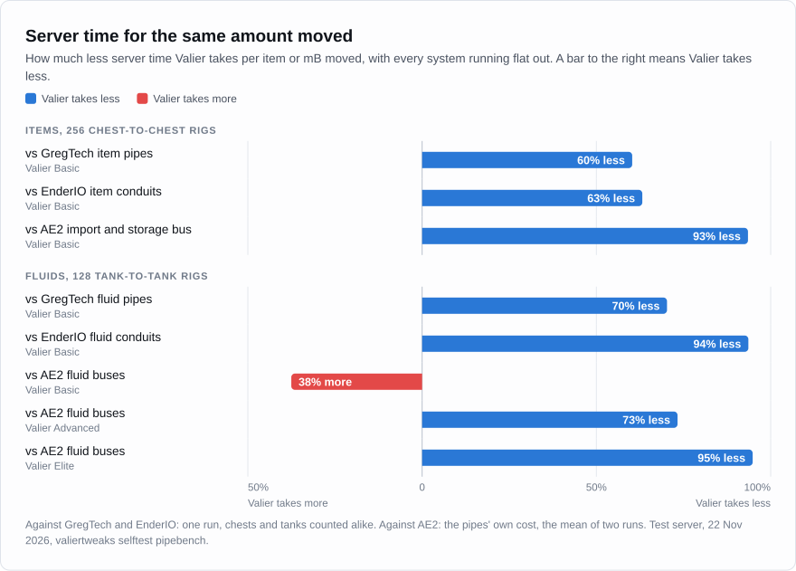
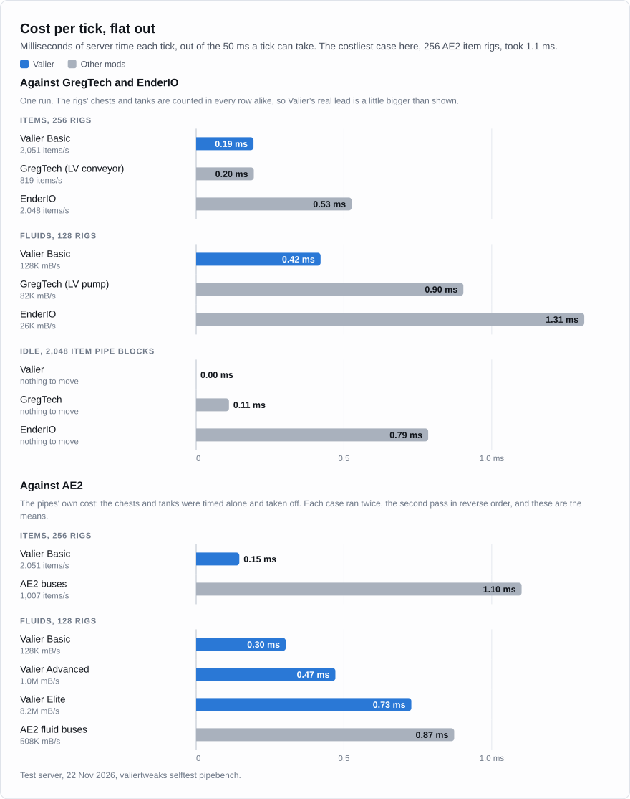

# Valier Tweaks

Gameplay additions for the Valier server. **Since 2.0.0 it is needed on the server and on every player's computer**
(it has its own blocks), and it includes what the old Valier Client mod did: players delete `valierclient-*.jar`.

The newest version is always at https://github.com/Eggonomicon/GTNH_Mods/releases/latest/download/valiertweaks.jar
(the same jar, named `valiertweaks.jar`; keep only one Valier Tweaks jar in `mods`).

## 2.3.5 and 2.3.4: endless wands, the op lock, WorldEdit by rank (server side only)

Players don't need a new jar for these: a 2.3 jar on their computer still joins.

- **Endless wands (2.3.5):** the server console's `/valier wand <player>` makes a Thaumcraft wand named "Endless Wand"
  (the pack's biggest plain rod with its cheapest caps) that belongs to that player.
  - While it is in its owner's inventory, or in a menu they have open (an Arcane Worktable's wand slot, a chest), the
    server keeps its six primal vis full (it looks every 4 ticks).
  - In anyone else's hands it's a plain wand that runs dry.
  - A wand made for a player who is offline waits for their next login.
  - Only the console can run it; players can't, ops included.
  - It only ever fills to the wand's own capacity: Thaumcraft draws the vis bars at their real height, so an over-full
    wand would paint them across the screen.
  - Config `thaumcraft` / `endlessWands`.
- **Op lock (2.3.4):** `permissions` / `opLock`: only the server console can op anyone. `opQuiet`: the console's `/op`
  and `/deop` tell nobody in game.
- **WorldEdit by rank (2.3.4):** `permissions` / `worldEditRanks`: a ServerUtilities rank with `worldedit: true` gets
  WorldEdit without op.
- **Wireless pipes (2.3.4):** a Wireless pipe joined into other pipes counts for the whole network (see Tags under
  Valier pipes).

## 2.3.3: Satchels on chests, refill and hotbar restock, send home to a barrel channel, ore dictionary on barrels, /valier cost

- **Sneak + right-click a container with a Satchel** (a chest, a double chest as one, a barrel, a machine, anything with
  an inventory). What it does is the Satchel's new container mode (the chest button in its menu; click for the next
  mode, right-click for the one before):
  - **put the selected item in** (the default),
  - **put everything in**,
  - **take out** what the Satchel holds (with "new items" on, anything; nothing it takes is ever destroyed by void
    overflow, which is only for things picked up off the ground),
  - **off** (the click places the selected item, as before).

  Every slot leaves its keep amount. A sided container is filled by the face clicked (a furnace's top is its input). A
  Valier barrel moves any count in one click. Claims are respected. A chat line says why when nothing moved.
- **Refill (per slot):** keep this many of the slot's item in your inventory, topped up from the Satchel twice a
  second (64 is a stack of blocks; shift-click the + for steps of 64). It waits while a chest or other menu is open,
  so what you put away doesn't come straight back. A blue mark (bottom right) shows a refilling slot.
- **Hotbar restock (for the whole Satchel, on by default):** when the stack in your hand runs out (the last block
  placed, the last pearl thrown, the last food eaten, a tool broken), a stack of it from the Satchel takes its place.
  Moving a stack away doesn't count as running out.
- **Send home (per slot):** link the slot to one of your team's barrel channels (the barrel button: click for the
  next channel that takes the slot's item, right-click for off). Picked-up items fill the slot to its keep amount, and
  the rest go straight into the channel, wherever its barrels are, loaded or not. A full slot empties into the channel
  before anything would be destroyed. What the channel can't take stays in the Satchel. Only your team can send: a
  Satchel given to someone else sends nothing. A green mark (top middle) shows a slot sending home. With refill on the
  same slot, give it a keep amount, or send home leaves nothing to refill from.
- **The Satchel's settings are in a panel on the right of its menu.** The new buttons made the menu too tall for a LuV
  Satchel at GUI scale 4.
- **Ore dictionary on barrels:** a new button in a barrel's menu. When on, items sharing an ore name with the barrel's
  item go in as its item, so one barrel takes every mod's copper ingots. This works by hand, with hoppers and with
  pipes. AE2 still sees each item apart and only offers the barrel's own item. It belongs to the channel, as lock and
  void overflow do.
- **Small safety fixes:**
  - A Satchel is never put into another Satchel (or Flask).
  - A barrel no longer swallows a Satchel or Flask right-clicked on it.
- **`/valier cost` (ops and the console):** how much server time Valier's own blocks and tweaks take, so lag can be
  pinned on them or ruled out without a profiler. `/valier` is now another name for `/valiertweaks`. For each part, costliest
  first: ms a tick over the last 10 seconds, over the last minute, the worst tick of the minute, and what is loaded.
  The parts are pipes, the Grid, barrels, Satchels, loot spawners, XP crafters, tree felling and peaceful dimensions.
  The last line is the total against the server's own tick time and TPS. On the test server, just after its self-tests:

  ```
  Valier cost, ms of server time a tick: last 10 s, last 34 s, worst tick.
   Tree felling: 0.101, 0.145, worst 2.020
   Pipes: 0.014, 0.018, worst 3.107 (0 pipes in 0 networks)
   Grid: 0.009, 0.017, worst 2.357 (0 blocks in 1 networks)
   ...
  In all: 0.127 ms a tick, 0.194 over the minute, worst tick 5.113, 7.1% of the server's 1.8 ms tick (20.0 TPS).
  ```

  Worst ticks of a few ms right after a start are one-off loads of saved data.

  It is measured all the time: two clock reads around each Valier tick handler (about 50 ns each), kept for a minute.
  Not counted: time other mods spend calling into Valier blocks. A hopper or AE2 filling a barrel is in their own
  time; Valier pipes filling one is in the pipes' time.
- **Needs 2.3.3 on players' computers** (the new menu and buttons). With an older jar the server still does the clicks,
  refill and restock.

## 2.3.2: shift-click into the Satchel, selecting from your inventory, Flasks on tanks, the selected slot framed

- **Fixed: shift-clicking a stack in your inventory into a Satchel or Flask looked like it did nothing** until the next
  click. The server put it in, but the game never told your screen (it expects the screen to have guessed the result,
  and it can't guess what a Satchel takes). The server now sends your inventory after such a shift-click.
- **Selecting:** ctrl-click or middle-click a slot, as before, or ctrl-click or middle-click an item in your own
  inventory below to select the Satchel slot holding it (a Flask: the tank holding the fluid in that bucket or cell).
- **The selected slot or tank has an orange frame**, drawn over its item or fluid (a fluid covered the old blue
  background completely, so the Flask's selected tank never showed).
- **Flasks on tanks:** right-click a tank or machine holding fluid to take it into the Flask; right-click an empty one
  to put the selected fluid in; sneak-right-click always puts in. It now comes before the block's own right-click, so
  Railcraft's iron and steel tanks (any wall, gauge or valve), GregTech's tanks and machines and other tanks with a menu
  work too. A Flask never pours its fluid out on top of a tank. When the selected tank is empty, the tank that just took
  fluid (from a tank, a source block or a bucket) becomes the selected one, so the next click puts it in again. A short
  chat line says why when nothing moved (no room, nothing selected, the tank doesn't take it).
- All of it is on the server except the frame and selecting from your inventory, which need 2.3.2 on players'
  computers.

## 2.3.1: Satchel menus stay open, barrels in WAILA and Holo Glasses, small Grid Plugs and Points, loot spawners push into pipes, a Creative barrel

- **Fixed: a Satchel's or Flask's menu closed again as soon as it opened** (right-click in the air). After every
  right-click the game swaps the held item for an equal copy of it, and the menu took that for the Satchel leaving the
  hand. It stays open now until it is closed (a different item in that slot still closes it).
- **Barrels in WAILA**, as JABBA's: what one holds ("640 of 32,768 Iron Ingot"), its tier and size in stacks, its
  channel, lock and void overflow. WAILA option "Valier barrels".
- **Holo Glasses (HoloInventory) show a barrel's whole count**, not the one stack its output slot gives automation.
- **Grid Plugs and Points are small nodes**, as Flux Networks' are: a core half a block wide (the face, small, with the
  network's ring of light) and an arm with a plate out to each energy block beside it (GregTech, IC2 or RF). Their
  collision follows the core and arms. Cells and the Controller stay full blocks.
- **Loot spawners push into Valier pipes.** A pipe face left on Provide (the default) or set to Push/Pull on a loot
  spawner takes each batch as it is made and sends it on to the network's Push faces (then Request faces short of it),
  with that face's Deny, Allow and Void lists. No Pull face is needed. A Pull face on a spawner still pulls from its
  store on its own timer, as before.
- **Loot spawner menu: upgrade buttons.** Under the status: Looting and Speed with - and + (one Looting or Speed item
  in from anywhere in your inventory, or one back out), and XP bottles and Damaged as Yes/No buttons (Yes on XP bottles
  and No on Damaged take their gold or emerald block from your inventory, and switching back gives it back). The
  tooltips say the level, how many are in it, how many more the next level takes, and what each costs. Sneak-clicks
  with the blocks still work.
- **Creative barrel** (creative tab and NEI only: no recipe, no upgrade): right-click it with an item and it gives that
  item without end (the stack stays in your hand; right-click with another item to change it). Left-click, hoppers,
  pipes and AE2 take as much as they like. It takes nothing in, unless its void overflow is on: then its item goes in
  and is destroyed. It can't be linked. WAILA and its label say "Endless".
- The Satchel fix, the Holo Glasses count and the spawner pushing into pipes need only the server's jar; the small
  nodes, the WAILA lines, the spawner menu's buttons and the Creative barrel need 2.3.1 on players' computers. 2.3.0
  players can still join a 2.3.1 server.

## 2.3.0: Valier Barrels (linked), Satchels and Flasks, the Valier Grid

- **Valier Barrels** hold lots of one item, in 7 tiers (Basic to LuV, 64 to 16,777,216 stacks). Barrels on the same
  **channel** share one store, anywhere, in any dimension, loaded or not: take one of 640 iron ingots out of any of
  them and every one shows 639. Lock, keep (automation leaves that many), void overflow, comparators, AE2 storage buses
  see the whole count. See [Valier Barrels](#valier-barrels-230).
- **Valier Satchels (items) and Flasks (fluids)**, LV to LuV and Creative: picked-up items go into a Satchel first;
  place blocks from it; a Flask picks up and places fluids and fills and drains tanks. The **Satchel Dock** lets pipes,
  hoppers and AE2 reach what a docked one holds. See [Satchels and Flasks](#valier-satchels-flasks-and-the-dock-230).
- **The Valier Grid**: wireless EU and RF, LV to UV. Plugs take power in, points send it out (GregTech machines at their
  own voltage, so nothing explodes), cells store it, the controller charges players' items. See
  [the Valier Grid](#the-valier-grid-230).
- **Every Valier recipe has a cheaper GregTech assembler version** (since 2.2.0).
- **The Pipe Configurator is the Valier Configurator** now: it copies and pastes Grid settings too.
- Players need 2.3.x to join a 2.3 server.

## 2.2.0: the loot spawner menu and loot filter, assembler recipes

2.2 was never released on its own: it ships in 2.3.0.

- **A loot spawner's menu**: right-click it (players who may change it). Its store (take the loot it is keeping), and
  its **loot filter**: an **Allow** list (only what it names comes out) and a **Void** list (what it names is destroyed
  as it is made; wins over Allow). Each list matches items or whole mods, by damage, **NBT** (one enchanted book, not
  another) and ore dictionary, as pipe lists do. XP bottles are filtered too. See [the loot spawner menu](#loot-spawner-menu-and-loot-filter-220).
- **Every Valier recipe has a GregTech assembler recipe** that costs less: about half the metal or bulk and no tools,
  the GT parts (circuits, conveyors, pumps, emitters) still one each. E.g. 8 Advanced pipes from 6 Basic ones (8 by
  hand).
- Players need 2.2.x to join a 2.2 server.

## 2.1.0: faster pipes, three filter lists, void, spread, WAILA, pick-up, copy settings, creative pipes

- **Two faster tiers:** Superior (HV) and Ultimate (EV). An Ultimate fluid face moves 640,000 L/s, against GregTech's
  Huge Dark Steel pipe's 111,360 L/s and Huge Potin's 24,000 L/s.
- **Three filter lists on every face at once:** Allow, Deny and Void, for items and fluids. Deny wins over the other
  two.
- **Void:**
  - a pulling face destroys what its Void list names in its block (keeping any amount you set);
  - a pushing face destroys what is sent to it and doesn't fit (overflow trash).
- **Priority is strict now**, and each pulling face picks how equal priorities share: in order, round robin or even
  split. In 2.0, the turn-taking could send things to a lower priority while a higher one still had room.
- **WAILA shows what each face does and what is flowing through the network.**
- **The wrench** picks a pipe up (sneak-right-click its centre).
- **The Pipe Configurator** copies a face's settings onto other faces.
- **Creative item and fluid pipes** make endless items or fluid for ops and creative players.
- **Joining:** a 2.1 server asks players for 2.1.x, so everyone updates from the link above. A 2.0 jar can't join a 2.1
  server, and a 2.1 jar can't join a 2.0 server.
- **2.0 faces keep working.** A whitelist becomes the Allow list, and a blacklist becomes the Deny list.

## 2.0.0: one jar, its own blocks, and pipes

- **One jar for everyone.** Put the jar in the server's and every player's `mods` folder, and delete
  `valierclient-*.jar`. If it is left in, Forge stops at start-up with a "duplicate mods" screen naming both files.
- **Joining:** a server with Valier Tweaks asks a joining player for the same major.minor version (any 2.1.x for 2.1).
  Fixes that only change the server don't need a new download. A player with it can still join servers without it.
- **Loot spawners and XP crafters are real blocks now** (Valier Loot Spawner, Valier XP Crafter).
  - Existing ones become the new blocks where they stand, the first time their chunk loads with 2.0.0.
  - They keep everything. A loot spawner keeps its mob, settings, upgrades, paid blocks and loot held. A crafter keeps
    its recipe, XP held, tank, slots and store.
  - Old items place the new blocks: a wrench's vanilla spawner item, or a crafter that was a GregTech tank item.
  - All clicks and recipes are as before.
- **Valier pipes:** item and fluid pipes, see below.
- **Removing the mod later** deletes its blocks from the world. Run `/valiertweaks revertblocks confirm` (ops, console)
  first: it turns loot spawners and XP crafters back into marked vanilla spawners and GregTech tanks.
  - Crafters' stores drop on top.
  - Loot spawners are only reverted in loaded chunks.
  - Pipes can't be kept.

## Valier pipes (2.0.0; 2.1.0 added tiers, the three lists, void, spread, WAILA, pick-up, the configurator, creative pipes)

Item pipes and fluid pipes move things straight from block to block. Nothing travels along the pipe, so a pipe holds
nothing in transit. They are built to cost the server as little as possible:

- **Pipes never tick.** Placing, breaking or changing one only marks it; the pipes joined to it are worked out again at
  the end of that tick. Idle pipes cost nothing at all.
- **Only pulling and Request faces work.** Each runs on its tier's interval, from one queue ordered by when each is due.
  - A face that finds nothing to do waits twice as long each time, up to `pipeMaxSleepTicks` (5 s).
  - A change inside the block it touches wakes it at its next interval.
  - All pipe work is capped at `pipeBudgetMicros` a tick; anything still due waits for the next tick.
  - Faster tiers move bigger batches at the same interval rather than running more often, so they cost about the same.
- **Never loads a chunk.** A face whose block is in an unloaded chunk waits for that chunk.
- `/valiertweaks pipes` (ops) shows the networks, the working and sleeping faces, transfers and the time spent.
  `/valier cost` (2.3.3) shows their time per tick next to everything else Valier does.

**Laying them:**
- A pipe joins pipes of its kind (any tier) and any block beside it with an inventory (item pipes) or a tank (fluid
  pipes).
- A pipe never joins a block in a chunk claimed by a team its owner (whoever placed it) isn't in or allied with.
- **The wrench (sneak-right-click):** on an arm, it shuts that side or opens it again. On the pipe's **centre**, it picks
  the pipe up into your inventory, with anything its faces were holding back (2.1.0).
- Pickaxes break pipes as before.

**Faces.** Where a pipe touches a block, a coloured plate shows that face's mode:

| Mode | Colour | What it does |
|---|---|---|
| Provide (new faces) | green | Passive. Request faces may take what they ask for from this block. With "Overflow" on, it also takes what pulling faces can't put anywhere else (a barrel as the network's buffer). |
| Push | blue | Passive. Pulling faces put things into this block. |
| Pull | orange | Every interval, takes up to its amount out of this block and sends it to Push faces, then Request faces short of it, then overflow Provide faces. |
| Push/Pull | teal | Both: pulls out of its block, and takes in what other faces send (a buffer). |
| Request | purple | Keeps what its Allow list names stocked in this block, taking only what's missing from Provide faces. Each entry keeps its own amount; without one, a stack (fluids: 1,000 mB). |
| Off | grey | Leaves the block alone. |

Nothing moves until some face pulls or requests. For example, a chest on a Provide face (no setup) and a machine on a
Request face asking for iron: the machine is kept stocked from the chest.

**A face's menu:** right-click the arm touching a block. Sneak-right-click it with an empty hand to cycle the mode
instead. The menu has:
- the mode;
- redstone: always, only with a signal, or only without one;
- on pulling faces, the **spread** (see below); on Provide faces, overflow;
- the priority (higher first);
- the amount per transfer (up to the tier's most) and the interval (never faster than the tier);
- the **tag**;
- the three **filter lists**.

**Filter lists (2.1.0).** Each face has three lists, picked by the tabs over the filter. All three work at once.
- **What each list has:** 18 ghost slots.
  - Click a slot with an item to set it (a stack sets an amount too); right-click to clear it.
  - The mouse wheel changes a slot's amount.
  - Items dragged from NEI work too, so nobody needs to own the item.
- **Each list is a whole filter of its own:**
  - what it matches: the listed items, anything from their mods, or (Allow and Deny) anything the block already holds;
  - damage: same, any, or only undamaged or damaged tools and armour (also 25, 50 or 75% worn or more);
  - NBT: same or any;
  - ore dictionary: on or off;
  - a snapshot button (the block's items become the list) and a clear button.
- **Deny:** what it names is never moved or destroyed by this face. It wins over the other two lists.
- **Void:**
  - On a Pull or Push/Pull face, what it names is destroyed in the face's block, within the face's amount per transfer.
    No destination is needed.
  - On a Void entry, an amount means "keep this many". For example, "Cobblestone, 1,000" destroys only the cobblestone
    over 1,000.
  - On a Push or Push/Pull face, what it names that is sent to this face and doesn't fit in the block is destroyed.
    The block is filled first, so with priority this is overflow trash: a priority-10 chest fills, then the rest is
    voided.
  - Void isn't used on Provide and Request faces.
- **Allow:** only what it names passes; an empty Allow list lets everything through. Its amounts are how much to keep in
  this block:
  - pulling and providing faces only give what is over the amount;
  - pushing faces fill up to it;
  - Request faces keep it stocked.
- **Fluids:** fluid faces use the same lists. An entry holding a fluid (a bucket, a cell, NEI's fluid) names it, and
  amounts are in mB.

**Priority and spread (2.1.0).**
- Destinations always fill strictly by priority (higher first): a lower priority only gets what the higher ones can't
  take.
- Push faces come first, then Request faces short of it, then overflow Provide faces.
- How equal priorities share is the pulling face's **spread** setting:
  - **In order:** the first fills first, then the next, and so on. Equal priorities always go in the same order (by
    place). To get "1, 2, 3", give them priorities 3, 2, 1.
  - **Round robin** (default): they take turns, one transfer each.
  - **Even split:** each transfer is shared equally, so 64 into three chests is 22, 21, 21. What one can't take goes to
    the others, then to the next priority.

**Tags:** a face only trades with faces carrying the same tag (no tag with no tag).
- On ordinary pipes that means channels within the pipes joined together.
- On **Wireless** (and creative) pipes it means links: a tagged face trades with every Wireless face of the same tag,
  anywhere, as long as both are in loaded chunks. "001 in, 001 out". Wireless pipes don't need to be joined by pipes.
- Since 2.3.4 a Wireless pipe joined into other pipes counts for the whole network. Every tagged face on that network
  links too, even one on a Basic or Elite pipe. Example: a Wireless pipe joined to an Elite pipe whose face on a machine
  is Push, tag Steam1, gets steam from your Steam1 Pull faces anywhere. Before, only the Wireless pipe's own faces
  linked. Items and fluids work the same way.
- Links work in any dimension (`pipeWirelessCrossDimension`).
- Tags are private to the pipe owner's ServerUtilities team (or to the owner alone without a team), so nobody else can
  send to or take from yours.

**Exact transfers:**
- It takes out first, and what really came out is what counts (some barrels and machines give a little more or less
  than they show).
- Then it puts in as a vanilla hopper does: stacks first, never past the block's stack limit.
- What nothing took goes back. If it can't, the face holds it and hands it on first next time. It holds a few stacks at
  most (`pipeHeldStacks`), and they drop if the pipe breaks.
- A double chest is one inventory, and a face never moves things into the block it takes them from.
- Slots and tanks follow the block's own rules for the side the pipe touches.

**Tiers and recipes.** Amounts and intervals are in the config, `pipes` section. The "per second" figures are for one
pulling or Request face.

| Tier | Per transfer | Every | Per second (items / fluid) | Recipe |
|---|---|---|---|---|
| Basic | 8 items / 1,000 mB | 20 ticks | 8 / 1,000 L | 6 bronze plates, 2 glass panes, a hopper (item) or bucket (fluid): 8 pipes |
| Advanced | 32 / 4,000 mB | 10 ticks | 64 / 8,000 L | 8 Basic around an LV conveyor (item) or LV pump (fluid): 8 |
| Elite | 64 / 16,000 mB | 5 ticks | 256 / 64,000 L | 8 Advanced around an MV conveyor or MV pump: 8 |
| Superior (2.1.0) | 160 / 40,000 mB | 5 ticks | 640 / 160,000 L | 8 Elite around an HV conveyor or HV pump: 8 |
| Ultimate (2.1.0) | 320 / 160,000 mB | 5 ticks | 1,280 / 640,000 L | 8 Superior around an EV conveyor or EV pump: 8 |
| Wireless | 64 / 16,000 mB | 5 ticks | 256 / 64,000 L | an Elite pipe, an ender pearl, an MV emitter and an MV sensor: 1 |
| Creative (2.1.0) | 4,096 / 1,000,000 mB | 5 ticks | endless | none: creative tab and NEI only |

For comparison, GregTech's fluid pipes (GTNH 2.9.0) carry a whole line's worth:

| GregTech pipe | Per second |
|---|---|
| Huge Potin | 24,000 L |
| Huge Dark Steel | 111,360 L |

**Creative pipes (2.1.0).** A creative item or fluid pipe makes endless items or fluid.
- **The source menu:** right-click the pipe's **centre**. It has:
  - an Allow list of what to make (items; or buckets, cells or NEI fluids);
  - a mode: Pull (pushes into Push and Request faces, by priority and spread), Provide (only Request faces take from
    it) or Off;
  - the amount, interval, spread and tag.
- **Where it reaches:**
  - Its sides work as ordinary faces too.
  - With a tag it links wirelessly like a Wireless pipe (same team), so it needs no block beside it.
  - What nobody takes simply isn't made.
- **Who can use it:**
  - Only ops and players in creative mode can place one, change its menus or wrench it up.
  - It can't be broken in survival, and explosions can't break it.

**Pipe Configurator (2.1.0)** copies settings, as EnderIO's conduit probe does.
- **Recipe:** shapeless: a Basic item pipe, a Basic fluid pipe, redstone and paper.
- **Copy:** sneak-right-click a pipe's arm. It copies that face's mode, amount, interval, priority, redstone, tag,
  overflow, spread and all three lists, but never what the face holds.
- **Paste:** right-click another face on the same kind of pipe (item to item, fluid to fluid). Claims are respected.
  Amount and interval still keep to the target tier's limits.
- **Creative pipes:** a creative pipe's centre copies and pastes its source settings, only onto another creative pipe's
  centre.
- **Clear:** sneak-right-click the air.
- **Tooltip:** shows what the configurator holds.

**WAILA (2.1.0, WAILA option "Valier pipes").**
- **Looking at an arm where it touches a block:**
  - that face's mode, tag, priority and spread;
  - how many entries each list has;
  - what it moved and voided over the last minute;
  - the last thing it moved and when;
  - anything it is holding back.
- **Looking at the centre:**
  - the network: pipes, working faces, and those waiting;
  - **what is flowing through it**: the things its working faces moved most over the last minute;
  - what was voided;
  - a creative pipe's source.

Pipes hold nothing in transit, so the flow is what's "in" the pipe system. The server sends the data only for pipes
someone is looking at, every quarter second.

Loot spawners and XP crafters work with pipes: pipes can take from both. One with only a Valier pipe pulling from it
(Pull or Provide) works; before 2.0, with nothing to push into, it would wait for "no output". From 2.3.1 a loot spawner
also pushes into the pipe: a face on it left on Provide or set to Push/Pull carries each batch straight to the
network's Push faces (then Request faces short of it), by that face's lists, with no Pull face anywhere. A Pull face
pulls from the spawner's store on its timer, as before (so it keeps the pipe tier's rate).

## Loot spawner menu and loot filter (2.2.0)

- **Opening it:** right-click a loot spawner (sneak-clicks still do what they did). Players who may change it (its
  claim's members) get the menu; anyone else gets its status, as a sneak-right-click with an empty hand gives.
- **Top:** the mob and how many a batch, what it is doing (hover for the full status).
- **Upgrades (2.3.1):** Looting and Speed with - and + (one item in from anywhere in your inventory, or one back out;
  one put in in creative just goes when taken out), and XP bottles and Damaged as Yes/No. XP bottles Yes and Damaged
  No take the config's item (a gold block, an emerald block) from your inventory; switching back gives it back. With
  the config's item missing or empty, the button can't switch it.
- **Store tab:** the 27 slots of loot nothing touching it took yet. Take from them; nothing goes in. The line under it
  says how much the filter destroyed in the last hour.
- **Allow and Void tabs**, the loot filter, each a full filter like a pipe face's list: 18 ghost slots (click with an
  item, drag one from NEI, or shift-click one in your inventory; right-click clears), items or mods, damage (exact, any,
  only damaged, only undamaged, worn 25/50/75%), NBT, ore dictionary, snapshot (the list becomes what the store holds),
  clear.
  - **Void** names what is destroyed as it is made. It wins over Allow.
  - **Allow**, when it names anything, is all that comes out; everything else is destroyed.
  - XP bottles go through the filter too.
  - Stored loot the filter now destroys goes at once, and the menu says how much.
- **Saved** with the spawner (in its mark, keys `Allow` and `Void`), also through a wrench pick-up; the item's lore says
  it filters. The emerald block's damaged-items filter still works and still refunds.

## Valier Barrels (2.3.0)

One kind of item, lots of it, with the item and its count on the front.

| Tier | Stacks | Iron ingots |
|---|---|---|
| Basic | 64 | 4,096 |
| LV | 512 | 32,768 |
| MV | 4,096 | 262,144 |
| HV | 32,768 | 2,097,152 |
| EV | 262,144 | 16,777,216 |
| IV | 2,097,152 | 134,217,728 |
| LuV | 16,777,216 | 1,073,741,824 |
| Creative (2.3.1) | endless | endless |

- **Clicks:** right-click puts the held stack in, a quick second right-click every matching item you carry; left-click
  takes a stack, sneaking one item. Creative players take a stack too, and break a barrel holding something only
  sneaking.
- **Menu** (sneak + right-click with an empty hand): lock (it keeps its item at 0), void overflow (full, it still takes
  its item and destroys it: a cobblestone sink), ore dictionary (2.3.3: items sharing an ore name with its item go in
  as its item; AE2 still offered only its own), keep (hoppers, pipes and the like leave that many), its channel.
- **Upgrade in place:** right-click a barrel with the Barrel Upgrade of the next tier; it keeps what it holds.
- **A wrench** (sneaking) picks it up with what it holds; broken any way, it drops as an item holding it all. Placed
  again it holds it again.
- **Linked barrels:** type a channel name in the menu (or click one of your team's) and Link. Every barrel on a channel
  shares one store, anywhere, in any dimension, loaded or not: take one out of any of them and it is gone from all. A
  channel holds the sum of its barrels' capacities. A channel is your team's (or yours alone, without a team; the
  same rule as wireless pipe tags).
  - Joining: a barrel holding something joins only an empty channel or one holding the same item; what it holds goes in.
  - Leaving (Unlink, broken, picked up): the barrel takes away what the rest can't hold, as its own; nothing is lost.
    Its item remembers the channel and joins it again when placed (the channel of that name in the placer's team).
- **Automation:** two slots, as barrels usually have: one always looks empty and takes what is put in, the other shows
  up to a stack to take. Valier pipes move their whole amount at once (an Ultimate pipe's 320). AE2 storage buses see
  the whole count. Comparators: 0 empty, 1 to 15 by how full.
- **WAILA and Holo Glasses (2.3.1):** WAILA shows what a barrel holds ("640 of 32,768 Iron Ingot"), its tier and size in
  stacks ("10 stacks + 0 of 512 stacks"), its channel and how many barrels share it, lock and void overflow (from what
  its label already shows: it asks the server for nothing). HoloInventory's Holo Glasses show the whole count.
- **Cost:** barrels never tick. A store changing a thousand times between updates costs one label update per loaded
  barrel showing it, at most every 10 ticks, sent only to players watching that chunk; labels are drawn within 16 blocks,
  facing the player.
- **Creative barrel (2.3.1):** from the creative tab or NEI. Right-click it with an item to set what it gives (the
  stack stays in your hand); right-click with another item to change it. It never runs out: left-click, hoppers, pipes
  and AE2 storage buses (which see 2,147,483,647) take what they like and its count stays. It takes nothing in, unless
  its void overflow is on, then its item goes in and is destroyed (a sink for that item). No upgrades, no channel;
  comparators read 15. A wrench or a break drops it as a Creative barrel still set to its item.

## Valier Satchels, Flasks and the Dock (2.3.0)

| Tier | Satchel slots × items each | Flask tanks × mB each |
|---|---|---|
| LV | 9 × 1,024 | 9 × 64,000 |
| MV | 18 × 4,096 | 9 × 256,000 |
| HV | 27 × 16,384 | 18 × 1,024,000 |
| EV | 36 × 65,536 | 18 × 4,096,000 |
| IV | 45 × 262,144 | 27 × 16,384,000 |
| LuV | 54 × 2,147,483,647 | 27 × 2,147,483,647 |
| Creative | 54, endless | 27, endless |

- **Satchel:**
  - **Pickup:** items you pick up that it holds go into it first, from anywhere in your inventory; with "new items"
    on, ones it doesn't hold take empty slots. Items you threw don't come straight back. Finding an item's slot is
    one lookup, however many slots it has.
  - **In hand:** right-click a block to place (or use) the selected item (a tool used this way wears, and the worn one
    goes to your inventory); right-click the air for its menu; sneak + mouse wheel picks the slot (shown beside the
    hotbar for 3 seconds).
  - **Menu:** click a slot for a stack (with one on the cursor: puts it in), right-click for one, shift-click for a
    stack into your inventory; shift-click in your inventory puts that stack in. Ctrl-click or middle-click selects
    the slot (an orange frame, 2.3.2), and so does a ctrl-click or middle-click on that item in your inventory below.
    The selected slot's settings (in a panel on the right since 2.3.3): keep (what shift-clicks,
    placing, chests, refills and automation leave), refill (2.3.3: keep that many in your inventory), ore dictionary (a
    picked-up item sharing an ore name is stored as this one), void overflow (full, picked-up matches are destroyed; on
    by default), lock (keeps its item at 0), send home (2.3.3: picked-up items over the keep amount go to a team barrel
    channel). For the whole Satchel: pickup on or off, new items too or not, hotbar restock (2.3.3), and what a
    sneak + right-click on a container does (2.3.3: put the selected item in, everything, take out, or off).
- **Flask:** right-click a fluid source to pick it up, a block to place the selected fluid. **On a tank or machine
  (2.3.2):** one holding fluid gives it to the Flask; an empty one gets the selected fluid; sneaking always puts the
  selected fluid in. This comes before the block's own right-click, so it works on tanks that open a menu: Railcraft's
  iron and steel tanks (any block of them, not just a valve), GregTech's tanks and machines, and anything else with
  tanks (a machine with no tanks still opens its menu). In its menu, click a tank to select it (an orange frame), with
  a bucket or cell to fill or empty it.
- **Upgrades** (MV to LuV): craft a Satchel (or Flask) with the next tier's upgrade; it keeps everything it holds.
- **Satchel Dock:** right-click with a Satchel or Flask to dock it, with an empty hand to take it back; broken, it drops
  it. Docked, pipes, hoppers, GregTech and AE2 reach what it holds: a Satchel's slots (keep amounts respected) plus an
  always-empty slot that takes anything it takes; a Flask's tanks.

## The Valier Grid (2.3.0)

Wireless EU and RF, in GregTech's tiers LV to UV.

- **Grid Plug:** power goes in. GregTech generators and cables push EU into it up to its tier's voltage (more is
  refused; nothing explodes), `gridAmps` amps a tick (4); IC2 generators and cables through IC2's energy net; RF
  generators RF.
- **Grid Point:** power goes out. GregTech machines get EU at **their own input voltage** (at most the point's), so
  nothing explodes; GregTech cables (they connect to a point as to a generator) at the voltage set in its menu, never
  over the cable's own, so it doesn't burn; IC2 machines in their tier's packets; RF machines RF,
  from RF that came in or EU at 3.6 RF per EU (GregTech's own rate).
- **Plugs and Points are small (2.3.1):** a core half a block wide and an arm with a plate out to each GregTech, IC2
  or RF block beside them, as Flux Networks' nodes; drawn into the chunk's mesh (redrawn when a neighbour changes).
- **Grid Cell:** stores EU, 1,000,000 at LV and 4 times more each tier (UV: 16,384,000,000). Broken or picked up, it
  keeps its energy.
- **Grid Controller:** charges its team's online players' items (armour, inventory, baubles: GregTech, IC2 and RF
  items) every half second, in any dimension. Each player can say "not me" in its menu.
- **Networks:** a name in your team, chosen in any block's menu. Blocks on a network share power anywhere, in any
  dimension, while their chunks are loaded. Each network has a colour, shown as a ring of light just inside its
  blocks' rims: one from its name until someone picks one of the 16 dye colours in a block's menu (saved with the
  world). The menu's **Blocks** page lists the network's blocks (up to 60): what each is, where (in another
  dimension: marked `*`), what it moved last second, and whether redstone has it off; plus the network's last minute in
  and out.
- **Who goes first:** points by priority (Surge before all); equal points share by what they want; what plugs give
  that no point takes charges the cells; points draw on cells when plugs don't give enough. Each block has a limit
  (EU a tick) and a redstone setting.
- **RF to EU** is off (`gridRfToEu`), as GregTech itself has it in this pack: RF that comes in only goes out as RF.
- **Loss:** none by default. With `gridLossPercent` set, what arrives costs the network that much more (at 10, 100 EU
  delivered takes 110); the menu and WAILA show what was lost.
- **The Valier Configurator** copies a block's settings (sneak-right-click) and pastes them (right-click); a network
  is pasted by name, in the pasted block's own team. A wrench picks a block up keeping its settings and network (placed
  by someone else, it joins that name in their team). WAILA shows a block's network, what it moved and a cell's energy.
- **Cost:** one loop a tick over each network's loaded blocks; neighbours are looked up again only when they change; a
  network with nothing to give is skipped.

## Recipes (by hand and in the assembler, 2.2.0 and 2.3.0)

Every Valier item has both. The assembler takes about half the metal or bulk and no tools; GregTech parts (circuits,
conveyors, pumps, emitters, sensors, hulls) stay one each.

| Item | By hand | Assembler |
|---|---|---|
| Basic pipes ×8 | 6 bronze plates, 2 glass panes, hopper/bucket | 3 plates, 1 pane, hopper/bucket |
| Advanced/Elite/Superior/Ultimate ×8 | 8 of the tier below + LV/MV/HV/EV conveyor or pump | 6 of the tier below + the part |
| Wireless pipe | Elite pipe, ender pearl, MV emitter, MV sensor | ×2 from 2 Elite, 1 pearl, the emitter, the sensor |
| Valier Configurator | Basic item pipe, Basic fluid pipe, redstone, paper | ×2 from the same |
| XP Crafter | 3 tanks, 2 LV pumps, LV conveyor, LV robot arm, crafting table, LV circuit | 1 tank, 1 pump, the rest |
| Basic barrel | 4 wood slabs, 4 planks, chest | 2 slabs, 2 planks, chest |
| Barrel Upgrade | 4 plates, 2 circuits, chest (LV) or conveyor, hammer, wrench | 2 plates, 1 circuit, chest or conveyor |
| Satchel / Flask (LV) | 4 steel plates, 2 LV circuits, LV conveyor/pump, chest/large steel fluid cell, hammer | 2 plates, 1 circuit, the rest |
| Satchel / Flask Upgrade | 4 plates, 2 circuits, conveyor/pump, hammer, wrench | 2 plates, 1 circuit, conveyor/pump |
| Satchel Dock | LV hull, 2 LV circuits, chest | hull, 1 circuit, chest |
| Grid Plug / Point | hull, emitter / sensor, 2 circuits, 2 cables (of its tier) | hull, emitter / sensor, 1 circuit |
| Grid Cell | hull, battery, 2 circuits | hull, battery, 1 circuit |
| Grid Controller | MV hull, 2 MV emitters, MV field generator | hull, field generator, 1 emitter |

Plates by tier: steel (LV), aluminium (MV), stainless steel (HV), titanium (EV), tungstensteel (IV), chrome (LuV).

## Lumber axes fell the whole tree

A Tinkers' Construct **lumber axe** fells a tree one log at a time and stops the moment the axe breaks, or the player
switches items. The rest of the tree is left floating. Tinkers has no setting for this.

With this mod, once a lumber axe chop stops early, the rest of the tree comes down too:

- **Same tree shape:** it walks the tree the way Tinkers does (each log, then the 3x3 around it on its own layer and
  the one above), starting from the logs Tinkers already broke.
- **Like breaking by hand:** the extra logs drop normally and the axe takes no more wear (it's broken, or not in
  hand).
- **Protection respected:** each extra log fires the normal block-break event, so claims and other protection mods
  still apply. A log they protect stays, and the rest of the tree still comes down.
- **Only real tree chops:** only chops Tinkers itself treated as a tree are finished (enough leaves at the top, player
  not sneaking). Breaking a single log, or a log wall without leaves, works as before.
- **A cap:** at most `maxExtraLogs` (1024) extra logs per tree. A lumber axe also fells logs that touch the tree, such as
  a log wall built against it.

The server log says when it finishes a tree: `Finished a tree for <player> at x y z: N more log(s), after the lumber
axe broke`.

Tinkers' Construct is optional: without it, the mod does nothing. It finds Tinkers' classes by name and has no hard
dependency.

## Peaceful personal dimensions (1.1.0)

Minecraft 1.7.10 has one difficulty for the whole server. This lets a player make just their own Personal Space
dimension peaceful:

| Command | What it does |
|---|---|
| `/pdim peaceful` | Shows whether the personal dimension you're in is peaceful. |
| `/pdim peaceful on` / `off` | Switches it for the personal dimension you're in. |
| `/pdim peaceful on\|off <dimension>` | Ops and the console: switch any loaded personal dimension. |
| `/pdim list` | Lists the peaceful dimensions. |

- **While on:** no hostile mob (anything Minecraft counts as a monster) can spawn there, whatever spawns it: natural
  spawning, spawners, eggs, commands or other mods. Hostile mobs already there, such as ones saved in chunks, are
  removed within a quarter of a second and drop nothing. Animals are left alone. As with peaceful difficulty, that
  includes bosses such as the Wither, so switch it off for a boss fight.
- **Who may switch it:** anyone who could break blocks where they stand, the same rule Personal Space uses for its
  portal settings. Claim your dimension's chunks to keep visitors from changing it. Ops always may.
- **Only personal dimensions:** it refuses everywhere else (the overworld, the Nether, planets).
- **Saved** with the world (`data/valiertweaks_peaceful.dat`).

Personal Space is optional: without it, `/pdim peaceful` simply finds no personal dimensions.

## Resetting a personal dimension (2.3.6)

Personal Space locks a dimension's layers and biome once it exists. `/pdim reset` starts one over:

| Command | What it does |
|---|---|
| `/pdim reset` | Next to the portal of a personal dimension (within 4 blocks, outside it): says what will be wiped and waits. |
| `/pdim reset confirm` | Within 30 seconds of that: resets it. |
| `/pdim reset <dimension>` then `/pdim reset <dimension> confirm` | Ops and the console: any personal dimension. |

- **What happens:** the dimension is unloaded and everything in its folder (chunks, chunk loaders' tickets, its data)
  moves to `pdim-reset-backups/<folder>-<time>/` next to the world. Only Personal Space's own settings file stays.
  Its layers and biome may then be changed once more in the portal's settings (sneak + right-click). The next trip in
  generates it fresh, and you land on the new ground with a new return portal: Personal Space alone would keep the old
  arrival height and build no return portal, so the mod moves every portal leading there to the new ground level + 1
  when the dimension loads again, and builds the return portal the tick after.
- **Who may:** anyone who could break the portal block, the same rule Personal Space uses for its settings, so claim
  the portal's chunk. Ops always may.
- **Only while nobody is in it:** checked when asked, when confirmed, and again at the start of the tick that unloads
  it (Forge would otherwise unload a world with a player in it).
- **Undo:** stop the server, move the files from the backup folder back into the dimension's folder.
- **Settings first (2.3.7):** until the new settings are saved (Done in the portal's settings, even without changes), a
  plain right-click on the portal sends nobody in and says why, since a trip in would generate the area with the old
  settings.
- `/pdim peaceful` stays as it was. Settings: `pdimReset` (default true), `pdimResetConfirmSeconds` (default 30).
  Saved: `data/valiertweaks_pdimreset.dat`.

## Real terrain for a personal dimension (2.3.7)

Personal Space only makes flat, layered worlds. `/pdim terrain realistic` gives a personal dimension Realistic World
Gen 2's own terrain for its biome instead, everywhere and without end: for Jungle Canyon, its canyons, cliffs of banded
hardened clay, jungle, rivers and river junctions, like the overworld's, but with nothing else (no oceans, coasts, other
biomes, volcanoes or lava caves).

| Command | What it does |
|---|---|
| `/pdim terrain` | Next to the portal: says whether the dimension has flat layers or real terrain, and its biome. |
| `/pdim terrain realistic` / `flat` | Next to the portal, before the dimension has generated anything (right after `/pdim reset`): sets it. |
| `/pdim terrain realistic\|flat <dimension>` | Ops and the console. |
| `/pdim rivers` (2.3.8) | Inside such a dimension: the nearest river (middle of its channel) and river junction, with coordinates, distance and direction, from RWG2's own river noise (right even where nothing has generated yet). |

- **Order:** `/pdim reset` and confirm; pick the biome (Jungle Canyon) in the portal's settings and press Done;
  `/pdim terrain realistic`; go in. The biome must have RWG2 terrain (in Valier's Personal Space list that's Jungle
  Canyon); the layers then only set the sky's horizon.
- **Arriving:** the click that starts the first trip points the portal up in the air (Personal Space's teleporter reads
  where to land at the click, before the dimension loads; 2.3.7 set it too late and landed a player inside a hill); at
  the end of that tick everyone who arrived there, at any height, is moved onto dry ground near the portal's spot (not
  water or leaves, room for the return portal and a player), where the return portal is built (2.3.8).
- **Rivers:** RWG2's rivers run along the borders of noise cells about 1,250 blocks across, so the nearest can be a few
  hundred blocks away; `/pdim rivers` finds it (the self-test checks there is water where it points).
- **How:** a server-side mixin in Personal Space's world provider gives such a dimension RWG2's chunk generator and a
  one-biome copy of RWG2's biome picker that answers "this biome, far inland, no volcano" everywhere; rivers and
  junctions are RWG2's own noise. The seed is the world's mixed with the dimension number. Players' clients are
  unchanged (they get chunks); portals, reset and peaceful work as for any personal dimension.
- **Not there:** GregTech ore veins (only RWG2's vanilla emerald and redstone showed up in the test).
- Setting `pdimRealisticTerrain` (default true; off: those dimensions generate flat again). Needs Personal Space and
  RWG2. Saved: `data/valiertweaks_pdimterrain.dat`.

## No ash from boilers (1.2.0)

GregTech's solid fuel boilers put ash or dark ash into their output slot as they burn coal, charcoal, coke and so on.
With this mod they don't:

- **Which boilers:** the small coal boiler and the high pressure coal boiler, and GT++'s LV, MV and HV advanced
  boilers. GregTech's other boilers (large boilers, lava, solar) never made ash.
- **Fuel works as before:** the same items count as fuel, last as long and make as much steam. Only the ash is gone.
- **Ash already in a boiler** stays until someone takes it out.
- **Not changed:** coke ovens make no ash anyway. Machines whose recipes list ash, such as the Bricked Blast Furnace,
  the Pyrolyse Oven and the Industrial Coke Oven, still make it.

It patches two GregTech methods at load time (mixins, loaded through UniMixins' late mixin loader, only when GregTech
is installed):

- **Small and high pressure coal boilers:** `MTEBoilerBronze.combustFuel`, which picks how much ash a burned item
  leaves, returns none.
- **Advanced boilers:** in `MTEAdvancedBoilerBase.consumeFuel`, the two calls that add tiny ash to the output slot add
  nothing.

## Railcraft boilers don't explode (1.13.0)

Railcraft blows a steam boiler up when water reaches it while it is **superheated** (300 or more) and its water tank
is **empty**: typically the water supply ran out while the firebox kept burning, and then the water came back. Its
explosion has no entity behind it, so `mobGriefing false` doesn't stop it, and neither do GregTech's machine
explosion settings; Railcraft itself has no setting for it.

With this mod (`noRailcraftBoilerExplosions`, on by default) it doesn't explode:

- **What happens instead:** the boiler hisses and puffs smoke, takes the water and cools to 299 (as Railcraft has it
  just before its explosion), and keeps working. Nothing breaks. The server log gets a line with where it was.
- **Only Railcraft boilers:** it cancels an explosion (Forge's `ExplosionEvent.Start`) only when it starts exactly at a
  Railcraft boiler block (a firebox or tank) and has no entity behind it. Every other explosion is untouched.
- **Without Railcraft** it does nothing. Clients need nothing.

## Loot spawners (1.3.0)

A mob farm spawns real mobs, which then have to be killed and their drops picked up: lag, and on a peaceful server
hostile spawners do nothing at all. A loot spawner skips the mobs and makes just their loot:

- **Making one:** sneak-right-click a mob spawner with a **block of diamond** (used up; not in creative). Any spawner
  works: one found in a dungeon or fortress, or one moved with JABBA's diamond dolly. The diamond block isn't placed.
- **What it does:** it stops spawning mobs. Every spawner cycle (its own timing; for a vanilla spawner, up to 4 mobs
  every 10 to 40 seconds) it makes the loot those mobs would have dropped and puts it into the inventories touching
  it, on any side: chests (double chests too), barrels, drawers, hoppers, machines, AE2 interfaces, GregTech item
  pipes, EnderIO item conduits and BuildCraft pipes.
- **Every side:** each stack is offered to all six neighbours in turn (below, above, north, south, west, east), and
  what doesn't fit in one goes on to the next. So with the chest below full, the loot goes into the chest beside it.
  From 1.14.0 storage (chests, barrels, drawers, machines) is offered everything first, and pipes and conduits only get
  what storage won't take.
- **When everything is full** it keeps that batch itself (up to 27 stacks) and makes no more until the loot has gone.
  Nothing is ever dropped on the ground. Hoppers under it, EnderIO conduits set to extract and AE2 import buses can
  also pull from what it keeps. With nothing touching it, it makes nothing.
- **The loot:** the mob is made in memory only (never added to the world, so no AI, pathfinding or ticking), then put
  through what a player kill runs: the mob's normal drops, its equipment, the 2.5% rare drop (a wither skull, say), and
  the drop event other mods add loot through. So drops only a player kill gives (blaze rods) come too. There's no
  Looting and no XP. Big slimes split into small ones and those drop slimeballs, as when killed. A spawner that dresses
  its mobs (a skeleton's bow, Nether skeletons that are wither skeletons) does so here too.
- **No damaged items (1.4.0):** sneak-right-click a loot spawner with a **block of emerald** and it throws damaged
  items away: the worn swords, bows and armour mobs drop never come out, only undamaged loot. Anything damaged it was
  keeping goes too. The emerald block is kept in the spawner (not in creative): do it again to switch it off and get
  the block back, and it drops if the spawner is broken. Gear a mob picked up drops undamaged, so that still comes
  out.
- **Looting from lapis blocks (1.7.0):** sneak-right-click a loot spawner with a **block of lapis lazuli** to put
  one in. Its mobs' loot is then rolled with Looting, as if killed with a Looting sword: 1 block gives Looting I, 3
  give Looting II, 6 give Looting III (`lootSpawnerLootingBlocks`; more numbers allow higher levels). One goes in per
  click; the message says how many more the next level takes. The level shows in its status, in players' hover
  ("Valier Loot Spawner: Zombie, Looting II") and in the wrench's item. The blocks stay in it and drop when it is
  broken. Claims apply.
- **XP as bottles o' enchanting (1.7.0):** sneak-right-click a loot spawner with a **block of gold** and the XP its
  mobs would have given a player comes out as bottles o' enchanting with the loot, one per 7 XP
  (`lootSpawnerXpPerBottle`; a thrown bottle gives 3 to 11, 7 on average). What is left over waits for the next batch.
  The gold block is kept in it: do it again to switch it off and get it back; it drops if the spawner is broken.
- **Infernal Mobs (1.7.0):** a loot spawner's mobs can be Infernal Mobs elites, as real spawned mobs are (1 in 20 on
  a GTNH server, by Infernal Mobs' own settings). An elite's extra loot comes out too: the enchanted chainmail, iron,
  gold and diamond armour witches were known for in mob farms, tools, books, potions and the rest of Infernal Mobs'
  lists, all undamaged, and its extra XP counts for bottles. `lootSpawnerInfernalMobs` switches it off.
- **Special Mobs (1.7.0):** a loot spawner's mobs are swapped for Special Mobs variants as real spawned mobs are (by
  its own weights; on a GTNH server every blaze, and some zombies, creepers, skeletons and others), and the variants'
  own loot comes out. `lootSpawnerSpecialMobs` switches it off.
- **Speed from cursed earth (1.8.0):** sneak-right-click a loot spawner with Extra Utilities' **cursed earth** to put
  one in. Its batches then come faster: 1 gives Speed I (twice as often), 3 give Speed II (3 times), 6 give Speed III
  (4 times) (`lootSpawnerSpeedBlocks`; more numbers allow higher levels, each one more time as fast). The batch
  already counting down speeds up too. Cursed earth placed right under a loot spawner counts as one put in
  (`lootSpawnerSpeedBelow`), the way it speeds up a vanilla spawner. One goes in per click; the level shows in its
  status, players' hover and the wrench's item; the blocks stay in it and drop when it is broken. However fast, a
  loot spawner makes at most one batch a second. Claims apply.
- **Cursed earth makes no real mobs (1.8.0):** Extra Utilities runs the vanilla countdown of any spawner standing on
  cursed earth and, when it reaches 0, spawns the spawner's mobs itself (persistent ones, no player needed). A loot
  spawner never used that countdown, so cursed earth didn't speed it up, but one left idle on cursed earth for about
  half an hour could start spawning real mobs. Its countdown is now kept full every tick, so it never gets there.
- **Taking the blocks back (1.7.0):** sneak and hit (left-click) a loot spawner with an empty hand: every lapis,
  cursed earth, gold and emerald block in it comes back to you, and Looting, Speed, bottles and the damaged-items
  filter switch off. The gold and emerald blocks can also be switched off on their own by sneak-right-clicking with
  that block again.
- **Existing loot spawners** get all of this as soon as the new version runs: every batch is rolled fresh.
- **Picking one up (1.5.0):** sneak-right-click a loot spawner with a **wrench** (GregTech's, EnderIO's Yeta wrench,
  AE2's quartz wrenches, BuildCraft's) and it comes off as an item called **Valier Loot Spawner** with its mob, say
  "Valier Loot Spawner (Zombie)". The item keeps its mob, its settings and its emerald block. The loot it was keeping
  drops. Place the item anywhere and it is a loot spawner again. Claims apply, as when making one. Placing works by
  hand (and by anything that places blocks the way a player does).
- **Changing its mob with a spawn egg (1.6.0, off by default):** with `lootSpawnerSpawnEggs` on, sneak-right-click
  a loot spawner with a spawn egg and it makes that mob's loot from now on, the mobs dressed as a vanilla spawner
  dresses them. The egg is used up (not in creative). Claims apply and blocked mobs are refused. What it was keeping,
  its timer and its emerald block stay. Plain spawners are left alone. (Botania's tooltip tip about spawn eggs is its
  own creative-only feature, and it doesn't change a loot spawner.)
- **What players see (2.0.0):** the Valier Loot Spawner block (a gold-framed cage) with its mob spinning inside
  (faster as the next batch comes up), and WAILA's name "Valier Loot Spawner (Zombie, Looting II)". 1.5.0 to 1.14.0
  showed a vanilla spawner with an empty cage instead (`lootSpawnerHoverName`, gone in 2.0.0).
- **Status:** sneak-right-click it with an empty hand to see its mob, its timing, whether it is working or waiting
  (and why) and when the next batch comes. On an ordinary spawner the same click says how to make one.
- **Protection:** it only works where the player could break the spawner, so claims keep others from converting
  yours. Ops always may.
- **No surprise mobs (fixed in 1.5.0):** EnderIO runs a spawner up to 6 times when a player breaks it, to spawn a last
  few mobs. The protection check above looks like a break to it. So a player who isn't an op could get a burst of real
  mobs when making a loot spawner, switching the emerald filter or picking one up, and breaking one did it for anyone.
  Now a loot spawner's own spawner part never runs: it needs a player within 0 blocks, and its real range is kept in
  the save. A plain spawner is held the same way for the moment it is being converted.
- **Breaking it (2.0.0):** players can't (in survival), and explosions and the Wither can't either: move it with a
  wrench. Creative players, a Matter Manipulator or another mod removing it: what it was keeping and the blocks paid
  into it drop. Before 2.0.0 a pickaxe broke it into EnderIO's broken spawner.
- **Blocked mobs:** the Wither and the Ender Dragon (`lootSpawnerBlockedMobs`).

How it is stored: since 2.0.0 it is its own block and tile (`valiertweaks.LootSpawner`), its state still in a small
compound (`ValierLootSpawner`) inside its spawn data. Before 2.0.0 it was an ordinary spawner marked that way; such a
spawner (an old save, or one a dolly moved) becomes the block as its chunk loads, or within 2 seconds if it turns up
some other way. Players' computers get a plain spawner tile for it, so vanilla draws the mob.

## XP crafters (1.9.0, menu and store 1.11.0, essence berries 1.12.0, cost settings 1.14.0)

GTNH has crafting recipes made only of XP buckets: a tiny pile of gallium dust from 8, a tiny pile of arsenic from 7,
a small pile of brick dust from 4, iron dust from 2, and so on (27 of them). An XP crafter makes them from liquid XP.

- **Making one (1.11.0):** a shaped recipe (mirrored works too; `xpCrafterTank` sets the tank):

  | | | |
  |---|---|---|
  | ULV fluid tank | LV pump | LV conveyor |
  | ULV fluid tank | crafting table | any LV circuit |
  | ULV fluid tank | LV pump | LV robot arm |

  The tanks are GT++'s **Ultra Low Voltage Fluid Tank**, empty (one holding fluid doesn't fit, so none is lost) and not
  crafters already. The result is a "Valier XP Crafter": one of the tanks, renamed, with a tooltip saying what it makes.
  1.9.0 and 1.10.0 made it from one tank and a block of diamond; crafters made that way keep working.
- **Placed, it is the Valier XP Crafter block (2.0.0; before, it stayed a ULV fluid tank).** Its tank holds 32,000
  mB and takes only liquid XP, from pipes, buckets and its menu (EnderIO and OpenBlocks call it `xpjuice`). Its input
  slot takes only liquid XP containers (emptied into the tank each second, the empties kept for pipes to take) and
  essence berries; pipes and hoppers can take its empties and its store. A crafter that was a GregTech tank becomes
  this block within a second of its chunk loading, keeping its fluid (whatever it was, however much), slots and
  record; its covers drop.
- **Its menu (1.11.0):** right-click it, with an empty hand or holding anything except a GregTech tool (wrench,
  screwdriver, mallet, hammer, crowbar, wire cutter, soldering iron, jackhammer) or a cover, which go to the tank as
  GregTech has them (1.11.0 needed an empty hand). It is a chest window the server fills, so every player sees it
  without a mod:
  - **Top row:** liquid XP (click it holding a bucket or cell of liquid XP to pour it in; shift-click pours the whole
    stack), a gauge of its tank, and its status (green working, yellow waiting, red stuck).
  - **The next three rows:** everything it can make (27), cheapest first, with the liquid XP each takes and what full
    dust would make. Click one to make it (it shines, "Making this now"); click it again to stop.
  - **The fifth row is its store:** what it made that nothing touching it took yet, up to 9 stacks. These are real
    items: take them (click, shift-click, a number key). Nothing can be put in.
  - **Bottom row:** full dust (click it holding a block of emerald to switch it on; click again to get the block back),
    pages if there are ever more than 27 things it can make, how many it has made, and how it works.
  - Clicks on the icons are buttons: nothing can be taken out of them, and the window is sent again after every click,
    so what the client guessed is put right. Where claims stop a player breaking it, they can look but not change it or
    take from its store.
- **Choosing what it makes** also works without the menu: sneak-right-click it with that item, such as a tiny pile of
  gallium dust. The item isn't used up. A dust no XP recipe makes is refused, with the list of what it can make.
  Claims apply.
- **What it does:** once a second it hands its store to the chests, inventories and pipes touching it (the same way
  loot spawners do: storage first, pipes only what storage won't take, from 1.14.0, so a pipe bringing it berries
  doesn't carry its output off into other crafters' tanks), takes the liquid XP it needs from its tank and makes the item, as many as it has XP for (at most
  64 a second) and room in its store, and hands those over too. A recipe's cost is the liquid XP in its buckets: 1,000
  mB a bucket, so a tiny pile of gallium dust takes 8,000 mB. It takes XP only as it needs it, so with nothing to make,
  or its store full, the XP stays in the tank. Before 1.11.0 it had no store and made nothing with nowhere to put it.
- **Solid XP (1.12.0):** when its tank hasn't enough liquid XP (or holds another fluid), it takes **essence berries**
  (Tinkers' Concentrated Essence Berry, what CropsNH's essence berry crop drops) from the chests and inventories
  touching it, as few as it needs, 250 mB each (`xpCrafterSolidXp`): the same as GTNH's fluid extractor makes from
  one, and what eating one gives on average (6 to 19 XP, at the 20 mB a point EnderIO and OpenBlocks count). Pipe a
  berry farm straight into the crafter (a GregTech tank takes items into its input slot; from 1.13.1 the crafter uses
  berries there, first), or into a chest next to it. From 1.14.0 a crafter's tank takes only liquid XP containers and
  essence berries from pipes, hoppers and other crafters, so nothing else can block its input slot (plain tanks still
  take anything, as GregTech has it). In its menu, click liquid XP holding berries to put one in
  (shift: the stack).
- **Bigger than the tank:** XP it has taken towards the next craft is held by the crafter itself, so a craft can cost
  more than the tank holds (72,000 mB for full gallium dust).
- **Full dust:** sneak-right-click it with a **block of emerald** (`xpCrafterFullItem`, kept in it; not in creative)
  and it makes the whole dust instead of a tiny or small pile, for 9 or 4 times the liquid XP: gallium dust from
  72,000 mB, arsenic dust from 63,000, brick dust from 16,000 (`xpCrafterTinyTimes`, `xpCrafterSmallTimes`; GregTech
  makes a dust from 9 tiny or 4 small piles). Recipes that already make a whole item don't change.
- **Cheaper (or dearer) crafts (1.14.0):** `xpCrafterCostPercent` scales every recipe's cost (25: a quarter, so a tiny
  pile of gallium dust takes 2,000 mB), and `xpCrafterCosts` sets single items, by ore dictionary name or item name,
  e.g. `dustTinyGallium=2000`. Full dust still takes 9 or 4 times the cost. The menu, the item's tooltip and WAILA show
  the cost the server uses. Changed in the config, they take effect at the next restart. Sneak-right-click
  with the emerald block again, or sneak and hit it with an empty hand, to switch it off and get the block back.
- **Status:** sneak-right-click it with an empty hand: what it makes, the XP each takes, whether it is working or
  waiting and why, its tank and the XP it holds, how many it has made and what its store holds.
- **Breaking it** (however: a player, an explosion, a Matter Manipulator) drops the XP crafter item with its recipe,
  emerald block, the XP it held and the liquid XP in its tank (2.0.0), and its store and slots as items; placed again,
  it carries on.
- **What players see:** the crafter block, NEI's recipe and listing (also under "@Valier"), the Valier creative tab,
  and WAILA's lines: what it makes, the cost, the status, its tank, the XP held, the count and its store (the server
  keeps each crafter's info ready, refreshed every second and whenever it changes, since WAILA asks on its network
  thread). WAILA option "Valier XP crafters" turns the lines off.

Stored in each world's `data/valiertweaks_xpcrafters.dat`, by position (the block holds the tank and slots).

## Whole steel dust from chain armour (1.9.0)

GregTech macerates a chain helmet into 5 small piles of steel dust and chain leggings into 7. With
`chainArmourFullDust` the helmet gives 1 steel dust and the leggings 2 (boots 1 and chestplates 2, as before), so a
full set still gives 6. Every GregTech macerator uses these recipes; they are changed at server start. Clients' NEI
still shows the small piles. The arc furnace (nuggets) is unchanged.

## Config (`config/valiertweaks.cfg`)

| Setting | Default | Meaning |
|---|---|---|
| `finishLumberAxeTrees` | `true` | Fell the rest of a tree when a lumber axe chop stops early. |
| `maxExtraLogs` | `1024` | At most this many extra logs per tree. |
| `logsPerTick` | `128` | Extra logs broken per tick (Tinkers' own rate). |
| `pdim` / `peacefulDimensions` | `true` | The `/pdim peaceful` switch. Off: no dimension is kept peaceful. |
| `boilers` / `noBoilerAsh` | `true` | Solid fuel boilers make no ash. Off: GregTech's normal ash. |
| `noRailcraftBoilerExplosions` | `true` | Railcraft boilers vent steam instead of exploding when water reaches them hot and dry. Off: Railcraft's explosion. |
| `lootspawner` / `lootSpawners` | `true` | Loot spawners work. Off: none can be made, and existing ones become ordinary spawners of the same mob again within 2 seconds of loading, dropping what they kept. |
| `lootSpawnerItem` | `minecraft:diamond_block` | What it takes to make one (`mod:item` or `mod:item:meta`). Empty: free, with an empty hand. A name that isn't an item: none can be made (a warning is logged). |
| `lootSpawnerItemCount` | `1` | How many of that item. |
| `lootSpawnerSpeed` | `1.0` | 1 = as fast as the spawner would spawn mobs; 2 = twice as often. |
| `lootSpawnerNeedsPlayer` | `false` | Only work with a player within 16 blocks, like a vanilla spawner. Off: whenever its chunk is loaded. |
| `lootSpawnerBlockedMobs` | `WitherBoss`, `EnderDragon` | Mobs whose spawners can't become loot spawners. |
| `lootSpawnerFilterItem` | `minecraft:emerald_block` | What makes a loot spawner throw damaged items away (kept in it, given back when switched off). Empty or not an item: it can't be switched (ones already set stay set). |
| `lootSpawnerFilterItemCount` | `1` | How many of that item. |
| `lootSpawnerLootingItem` | `minecraft:lapis_block` | What gives a loot spawner Looting, one per click. Empty or not an item: none can be put in. |
| `lootSpawnerLootingBlocks` | `1, 3, 6` | How many it needs for Looting I, II, III (rising; more numbers, higher levels). |
| `lootSpawnerSpeedItem` | `ExtraUtilities:cursedearthside:0` | What gives a loot spawner Speed, one per click. Empty or not an item: none can be put in. |
| `lootSpawnerSpeedBlocks` | `1, 3, 6` | How many it needs for Speed I, II, III: 2, 3 and 4 times as often (rising; more numbers, higher levels). |
| `lootSpawnerSpeedBelow` | `true` | That item as a block right under a loot spawner counts as one put in. |
| `lootSpawnerXpItem` | `minecraft:gold_block` | What switches bottles o' enchanting on (kept in it, given back when switched off). Empty or not an item: it can't be switched. |
| `lootSpawnerXpItemCount` | `1` | How many of that item. |
| `lootSpawnerXpPerBottle` | `7` | XP per bottle o' enchanting. |
| `lootSpawnerInfernalMobs` | `true` | Infernal Mobs elites and their loot, as with real spawned mobs. |
| `lootSpawnerSpecialMobs` | `true` | Special Mobs variants and their loot, as with real spawned mobs. |
| `lootSpawnerWrench` | `true` | Sneak-right-click with a wrench picks a loot spawner up as a Valier Loot Spawner item. |
| `lootSpawnerSpawnEggs` | `false` | Sneak-right-click with a spawn egg changes a loot spawner's mob (egg used up). |
| `xpcrafter` / `xpCrafter` | `true` | XP crafters can be made and work. Off: none can be made, and existing ones stop (keeping what they know). |
| `xpCrafterTank` | `gregtech:gt.blockmachines:817` | The GregTech tank three of which (with two LV pumps, an LV conveyor, an LV robot arm, a crafting table and an LV circuit) craft one (GT++'s ULV fluid tank). Any GregTech tank works. Not an item: none can be made. (1.11.0 removed `xpCrafterItem`, the diamond block of the old recipe.) |
| `xpCrafterFluids` | `xpjuice` | Fluids that count as liquid XP. Recipes made only of containers of these are what it can make. |
| `xpCrafterSolidXp` | `TConstruct:oreBerries:5=250` | Items it takes as liquid XP (`mod:item:meta=mB`), from inventories touching it or its menu. By default Tinkers' Concentrated Essence Berry, 250 mB. |
| `xpCrafterFullItem` | `minecraft:emerald_block` | Switches full dust on (sneak-right-click, or its menu; kept in it, given back when switched off). |
| `xpCrafterTinyTimes` | `9` | Times the XP for a whole dust instead of a tiny pile. |
| `xpCrafterSmallTimes` | `4` | Times the XP for a whole dust instead of a small pile. |
| `xpCrafterCostPercent` | `100` | Every XP recipe's liquid XP, in percent of GTNH's XP bucket recipe (1 to 1000). |
| `xpCrafterCosts` | (empty) | Items whose craft costs a set amount instead, as `item=mB`: an ore dictionary name (`dustTinyGallium=2000`) or `mod:item[:meta]`. Entries that set nothing are named in the server log. |
| `macerator` / `chainArmourFullDust` | `true` | Chain helmets macerate into 1 steel dust, chain leggings into 2. |
| `pipes` / `pipeItems` | `8, 32, 64, 64, 160, 320, 4096` | Items one pulling or Request face moves per transfer at most, per tier in metadata order (Basic, Advanced, Elite, Wireless, Superior, Ultimate, Creative). A 2.0 config's four-value list gets the new tiers' defaults added. |
| `pipeFluids` | `1000, 4000, 16000, 16000, 40000, 160000, 1000000` | The same for fluid (mB). |
| `pipeTicks` | `20, 10, 5, 5, 5, 5, 5` | Ticks between a working face's transfers, per tier. |
| `pipeMaxSleepTicks` | `100` | Longest wait of a face that keeps finding nothing to do (20 to 1200). |
| `pipeBudgetMicros` | `2000` | Most time a tick spent on pipes, in microseconds; the rest waits a tick. |
| `pipeNetworkMax` | `4096` | A network of more pipes than this does nothing (a safety limit). |
| `pipeWirelessCrossDimension` | `true` | Wireless pipes link across dimensions. |
| `pipeHeldStacks` | `4` | Stacks a face may hold back before the oldest drops. |
| `barrels` / `barrelStacks` | `64, 512, 4096, 32768, 262144, 2097152, 16777216` | Stacks of its item a barrel of each tier holds (Basic, LV to LuV). (2.3.0) |
| `satchels` / `satchelSlots` | `9, 18, 27, 36, 45, 54, 54` | Slots of each Satchel tier (LV to LuV, Creative), 1 to 54. |
| `satchelPerSlot` | `1024, 4096, 16384, 65536, 262144, 2147483647, …` | Items one Satchel slot holds, per tier. |
| `flaskTanks` | `9, 9, 18, 18, 27, 27, 27` | Tanks of each Flask tier. |
| `flaskPerTank` | `64000, 256000, 1024000, 4096000, 16384000, 2147483647, …` | mB one Flask tank holds, per tier. |
| `grid` / `gridAmps` | `4` | Amps a Grid plug takes and a point sends a tick, at its tier's voltage. |
| `gridCellEu` | `1e6, 4e6, … 1.6384e10` | EU each Grid Cell tier (LV to UV) holds. |
| `gridRfToEu` | `false` | RF that comes in may go out as EU. Off, as GregTech has it in this pack. |
| `gridRfPerEu` | `3.6` | RF per EU, both ways (GregTech's own rate). |
| `gridControllerCrossDimension` | `true` | Controllers charge players in any dimension. |
| `gridLossPercent` | `0` | EU and RF lost on the way, as a percentage of what arrives (0 to 90). |
| `permissions` / `opLock` | `false` | Only the server console can op anyone. `/op` from a player (whatever their op level or rank), a command block or RCON is refused and logged. `/deop` and every other command work as before. (2.3.4) |
| `opQuiet` | `false` | The console's `/op` and `/deop` tell nobody in game: vanilla shows every op online, the newly opped player too, a grey "[Server: Opped X]" line. Only the console sees it. (2.3.4) |
| `worldEditRanks` | `true` | WorldEdit also asks the player's ServerUtilities rank, so a rank with `worldedit: true` (or single `worldedit.*` nodes, the more exact one winning) gets WorldEdit without op. Ops keep it either way. (2.3.4) |
| `thaumcraft` / `endlessWands` | `true` | Wands made with the server console's `/valier wand <player>` keep their vis full while their owner carries them (or has them in an open menu, such as an Arcane Worktable); in anyone else's hands they are plain wands. Off: every endless wand is a plain wand and `/valier wand` refuses. (2.3.5) |

## Build and test

- **Build:** `gradlew --offline assemble` (JDK 25). It compiles against a GTNH 2.9 server's Tinkers' Construct,
  UniMixins, GregTech, GTNHLib, ModularUI 2, AE2 and WAILA jars (see `dependencies.gradle`). Point it at your server folder with
  `-PgtnhInstance=<folder>`; by default it is `../../GTNH_Instance`.
- **Self-test:** on a test server started with `-Dvaliertweaks.selftest=true`, run `valiertweaks selftest trees`. It
  builds four trees and a log wall, and fake players chop them with real Tinkers lumber axes:
  - A, with an axe that has 3 uses left: the whole tree falls, every log drops, and the axe broke.
  - B, with a fresh axe: Tinkers fells it all, and this mod does nothing.
  - C, a log wall without leaves: no more than Tinkers' own 3x3 goes.
  - D, a sneaking player: only the clicked log goes.
  - E, with one log protected by a cancelled break event: everything but that log falls.

  The results are checked 3 seconds later, and the area is cleared afterwards.
- **Peaceful self-test:** `valiertweaks selftest peaceful` (same flag). The test world's overworld stands in for a
  personal dimension.
  - **Command:** it refuses outside a personal dimension and refuses a non-op naming a dimension. A player may switch
    it only where a break would be allowed.
  - **Spawning:** with peaceful on, a new zombie can't spawn, natural spawning is denied and a cow is unaffected. A
    zombie that was already there is gone 10 ticks later.
  - **Saving:** the list saves and loads.
- **Boiler self-test:** `valiertweaks selftest boilers` (same flag). It places a small coal boiler, a high pressure coal
  boiler and an LV advanced boiler as a player would, then runs coal through each boiler's own fuel step.
  - **Ash off (the setting):** 60 coal burn and each heats the boiler, and the ash slot stays empty. 4 coal blocks
    (normally a full dust of dark ash each) leave none either.
  - **Ash back on**, to show the test reaches GregTech's ash code: the same 60 coal leave ash, and a coal block leaves
    one dust of dark ash.
  - The setting is put back and the boilers are removed.
- **Railcraft boiler self-test:** `valiertweaks selftest railboiler` (same flag), in an empty chunk of the test world.
  It builds Railcraft's smallest boiler (a solid firebox with a low pressure tank on it) as a player would, waits for
  it to form, puts dirt two blocks from it, then sets it off through Railcraft's own code: the boiler is made
  superheated with an empty water tank, water is poured into the firebox, and the firebox ticks.
  - **On (the setting):** Railcraft cooled it to 299 (its explosion code ran), the explosion is stopped, and the
    boiler, its water, the dirt and the formed boiler are all still there.
  - **Other explosions:** an explosion with no entity behind it a few blocks away still breaks its dirt.
  - **Off**, to show the test reaches Railcraft's real explosion: the same steps blow the dirt away.
  - The setting is put back and the area cleared.
- **Loot spawner self-test:** `valiertweaks selftest lootspawner` (same flag), in an empty chunk of the test world.
  - **Clicks:** a sneaking fake player with diamond blocks makes one (one block used, none placed). Not sneaking does
    nothing, an empty hand shows the status or a hint, and a protected spawner or a Wither spawner is refused.
  - **Loot:** zombies, blazes (blaze rods), spiders, slimes (splitting) and wither skeletons from spawn data (the rare
    skull, no arrows). Nothing for a blocked mob or an arrow, and nothing joins the world.
  - **Output:** into a chest; kept when the chest is full and handed over later; nothing with nothing touching it;
    into a hopper beside it; pulled by a hopper under it; nothing can be put into it; a GregTech item pipe connects
    to it and takes its loot.
  - **Damaged items:** an emerald block switches it to throwing damaged items away (one block kept in it, a worn
    sword it was keeping gone, the status says so, it survives a save) and switches it back, giving the block back.
    A protected one can't be switched, and a plain spawner only says how. Zombies with swords that drop worn give
    worn swords, none once it throws damaged items away, and swords that drop undamaged still come out.
  - **Wrench:** a real GregTech steel wrench counts (its hammer and a pickaxe don't). A sneaking fake player picks a
    loot spawner up as a "Valier Loot Spawner (Zombie)" item with the zombie's id, the loot it kept dropping. Not
    without sneaking, not where protected, not a plain spawner, not with `lootSpawnerWrench` off. Placed through
    Forge's own placement, the item is the same loot spawner (mob, its own settings, emerald block, a fresh wait), and
    NEI naming another mob for it changes nothing. A claim that stops placing keeps the item, and with loot spawners off
    it places a plain zombie spawner, dropping the emerald block. The hover packet names it and carries no spawn data;
    with `lootSpawnerHoverName` off it carries the mob and its spawn data.
  - **Spawn eggs:** with `lootSpawnerSpawnEggs` off (the default) an egg changes nothing. On, a skeleton egg makes a
    zombie loot spawner a skeleton one (one egg used, its loot and emerald block kept, saved as a skeleton spawner,
    the hover renamed). The same mob again, an egg with no mob, a blocked mob and a protected spawner use nothing, and
    a plain spawner is left alone.
  - **Every side:** with the chest below full, a batch goes into the chest beside it.
  - **Gold block:** XP is counted as for a player kill (10 blazes give 100, cows 1 to 3 each). Without a gold block
    no bottles; with one (kept in it), 4 blazes (40 XP) give 5 bottles with 5 XP kept, the next 4 give 6 more with
    3 kept. The status says so, it survives a save, a protected one can't be switched, switching it off gives the
    block back, and on a plain spawner it only says how.
  - **Lapis blocks:** 1, 3 and 6 give Looting I, II and III (the setting changes that), and zombies rolled with
    Looting III drop far more rotten flesh. One block per click, none where protected, none past the most. The
    status, the hover and the wrench's item say Looting III, a placed one keeps it, and breaking it drops its 6
    blocks.
  - **Infernal Mobs:** with its rarity set to 1 for the test, every witch is an elite: armour comes out, none of it
    damaged, the elites' extra XP counts, and none stay in its list. With `lootSpawnerInfernalMobs` off, no elites.
    (It is off for the rest of the test, so counts stay exact.)
  - **Special Mobs:** every blaze and some zombies come as its variants, killed for loot and never in the world or
    in its replacement queue. With `lootSpawnerSpecialMobs` off, plain blazes. (Off for the rest of the test too.)
  - **Taking back:** a sneaking hit with an empty hand gives back 3 lapis, the gold and the emerald block and switches
    those off. Not without sneaking, not where protected, and an empty one says so.
  - **Cursed earth:** 1, 3 and 6 give Speed I, II and III; batches of a 400-tick spawner come every 200 then 100
    ticks, and the one counting down speeds up too. One per click, none where protected, none past the most. The
    status, the hover, the wrench's item and a save keep Speed III; a sneaking hit gives the 6 back and its normal
    speed. One under it counts as one (not with `lootSpawnerSpeedBelow` off). On a plain spawner, only a hint. Extra Utilities
    counts a plain spawner on cursed earth down 100 at a time (300 to 200); a loot spawner's count is full again after
    each of its own ticks, so it never reaches 0 and no real mob comes out.
  - **No surprise mobs:** with a player beside them, a plain spawner counts as active and a loot spawner doesn't. Run
    6 times the way EnderIO does on a break, the loot spawner spawns nothing. A plain spawner isn't active while its
    conversion is being asked about. The real player range (16) is still saved and sent to clients.
  - **Saving:** it saves as a plain spawner with its loot inside and would load as one without the mod. It comes back
    after a dolly-style move and as its chunk loads, and clients get a plain spawner packet without the loot data.
  - **Settings:** a misspelled conversion item makes none (not free ones); blown up, what it kept (and its emerald
    block) drops; switched off, it is a plain spawner again (dressed as before, ready to spawn) and what it kept drops
    on top, emerald block included. A real chicken
    nearby is never taken as a baby zombie's mount during 2000 zombie rolls.
  - **Over 70 ticks:** a broken one drops what it kept and its emerald block (a permission check alone doesn't). Its chunk unloads and loads
    again with it still working, and one left running fills its chest on its own.
- **XP crafter self-test:** `valiertweaks selftest xpcrafter` (same flag), in an empty chunk of the test world.
  - **Recipes:** GTNH's XP bucket recipes are found with their costs (tiny gallium 8,000 mB, tiny arsenic 7,000, small
    brick 4,000, iron dust 2,000, charcoal 1,000). Full dust: 9 times for a tiny pile (gallium dust), 4 times for a
    small one (brick dust), none for iron dust. Cost settings (1.14.0): with `dustTinyGallium=2000` and charcoal at 300
    set, and the rest at 50%, tiny gallium takes 2,000 (full gallium dust 18,000), charcoal 300, tiny arsenic 3,500 and
    iron dust 1,000; entries that set nothing are ignored, and with the settings put back the costs are GTNH's again.
  - **Crafting:** LV circuits are in the ore dictionary; three ULV fluid tanks, two LV pumps, an LV conveyor, an LV
    robot arm, a crafting table and an LV circuit make the crafter item (name and tooltip), mirrored too. Not with a
    conveyor for the arm, an LV tank, a crafter or a tank holding fluid among the tanks, nor the old tank and diamond
    block. In a crafting table it is in the output slot, the one the server sends to players. With Valier Client
    loaded, its copy of the recipe (for NEI) takes the same grid and not the wrong one.
  - **Working:** placed as a player places it, it is a crafter. An empty hand shows its status; a tiny pile of gallium
    chooses that (not without sneaking, not where protected); titanium dust is refused. 5,000 mB makes nothing yet,
    3,000 more make one into the chest, 20,000 make two more and keep 4,000. An emerald block switches to gallium dust
    from 72,000 mB, taken a tank at a time.
  - **Item and edge cases:** broken, it drops as the item with its recipe, emerald block and 4,000 mB, and placed again
    it carries on. A sneaking empty-hand hit gives the emerald block back. With nothing touching it what it makes waits
    in its store; with its store full no XP is taken (and it says why); with the chest full too it waits; with room in
    the chest a stack of its store goes in and it makes another. Its record saves, store too; removed without drops,
    it is forgotten and its 513 stored items drop where it was. A plain ULV tank only gets a hint.
  - **Menu (1.11.0), on a crafter of its own:** a right-click opens it with an empty hand or holding dirt (1.11.1),
    not holding a GregTech wrench or a cover (an LV pump). It
    shows the 27 things it can make, cheapest first, with costs, its empty tank and its status, and no pages.
    Clicking tiny gallium dust chooses it (it shines), again stops it, a shift-click chooses too. Icons can't be taken
    (click, number key, Q) or covered. A liquid XP bucket poured in fills the tank, the gauge shows it and the empty
    bucket stays on the cursor; dirt is refused. The 2 it makes from 16,000 mB wait in its store and show in the menu;
    with its store full it takes no XP and says why in red. Its store can be taken from (shift-click, click, number
    key) but not filled. Full dust from emerald blocks on the cursor (the gallium icon becomes gallium dust at 72,000
    mB) and back. Where protected it can be looked at but not changed or taken from. Further than 8 blocks it closes.
    Broken, its store drops with the crafter item.
  - **Essence berries (1.12.0):** a Concentrated Essence Berry counts as 250 mB, another ore berry doesn't. From a chest
    of 40 berries a crafter takes 32 for a tiny pile of gallium dust (which goes into the same chest), then the other 8
    towards the next, leaving the dirt in it. The tank's liquid XP goes first, then berries. With water in its tank it
    still crafts from berries, then says its tank holds something else. Clicking the menu's liquid XP holding berries
    puts one in, a shift-click the rest. The test also logs what GTNH's fluid extractor, centrifuge and macerator make
    of a berry (17 Nov: the fluid extractor 250 mB of liquid XP, the others nothing).
    From 1.13.1: the tank accepts berries from below as a pipe offers them, and 40 berries in the crafter's own tank
    are used, 21 to finish a tiny pile it held 2,750 mB towards, the other 19 towards the next.
  - **WAILA (1.10.0):** the data WAILA's server sends for the crafter (every provider registered for the tank, as
    WAILA asks them) says what it makes and the cost as soon as it is chosen; working, the 4,000 mB held and 3 made;
    gallium dust at 72,000 mB with full dust on; with its store full and nothing touching it, why, the 8,000 mB in its
    tank and the 576 stored items; nothing
    once it is forgotten, and nothing for a plain tank. With `valierclient` in the test server's `mods` too, Valier
    Client's name and line providers are run on that data, and the lines a player reads are checked (see its README).
  - **Chain armour:** the macerator recipes give 1, 2, 1 and 2 steel dust for helmet, leggings, boots and chestplate,
    also as a macerator looks them up.
- **2.0.0 self-tests** (same flag): `valiertweaks selftest mod` (one jar: the stub `valierclient` mod id, language
  file, server proxy), `valiertweaks selftest pipes` (in an empty chunk, after loading the chunks around it so nothing
  is generated over the rigs) and `valiertweaks selftest pipeperf`.
  - **Pipes:** joining chests and pipes but not stone, a wrench shutting a side, new faces being Provide, Pull to Push
    moving every item with none lost, an iron whitelist, a Request face keeping 10 iron stocked, a double chest counted
    as one inventory, liquid XP between two crafters, Wireless tags linking one owner's pipes and not another's, a loot
    spawner working with only a Valier pipe pulling from it, idle faces sleeping longer, keep amounts on Pull and Push
    faces, existing-item filters, Push/Pull faces, damage and mod filters, and `/valiertweaks pipes`.
  - **Speed:** 512 chest-pipe-pipe-chest rigs (1,024 working faces: moving, idle and Request) cost 0.195 ms a tick
    (limit 1 ms).
  - **19 Nov 2026, Valier Tweaks 2.0.0 (as 2.0.0-pre2):** all nine steps on the test server, 276 checks, none failed
    (mod 6, lootspawner 123, xpcrafter 70, pipes 18, pipeperf 2, railboiler 12, boilers 18, trees 12, peaceful 15).
    Converting a copy of the Valier world (3 loot spawners, 27 XP crafters) kept every setting, upgrade, paid block,
    crafter record and slot.
- **2.1.0 pipe self-tests** (in `valiertweaks selftest pipes`, two and four blocks above the 2.0 rigs):
  - **Priority and spread:** priority 10 before 0, in 4-item transfers, where 2.0 sent every other one to 0.
    Round robin between two equal chests (12 / 8). Even split of one 64 transfer (22 / 21 / 21). In order (the first
    takes all 30).
  - **Lists and void:** three lists at once (allowed cobblestone moved, denied dirt neither moved nor voided, sticks
    voided). A Pull face's Void list keeping 40 of 100 cobblestone, with nowhere to send anything. A Push face's Void
    list filling its chest and destroying the 54 that don't fit. Liquid XP voided down to 4,000 mB, and Deny winning over
    Void for fluids too.
  - **Creative pipes:** Pull filling a chest, Provide keeping a Request face at 100, a tagged creative pipe reaching a
    far Wireless pipe, and a creative fluid pipe filling an XP crafter. Only creative players and ops may change one,
    and it can't be broken in survival.
  - **Wrench, configurator, filters:** the wrench on a centre picking up the pipe and what it held back. The Pipe
    Configurator copying a face onto another (which keeps what it holds). 2.0 whitelists and blacklists read as Allow
    and Deny lists.
  - **Tiers, recipes, WAILA:** the new tiers' amounts, the recipes (none for creative), and the WAILA lines for a face
    and for the centre.
  - **20 Nov 2026, Valier Tweaks 2.1.0 (as 2.1.0-pre1):** all nine steps, 300 checks, none failed (mod 6, lootspawner
    123, xpcrafter 70, pipes 42, pipeperf 2, railboiler 12, boilers 18, trees 12, peaceful 15). Speed: 0.203 ms a tick
    for 1,024 working faces, the same as 2.0.
- **2.2.0 self-tests:**
  - **Loot filter** (in `valiertweaks selftest lootspawner`): Void lists by item, by NBT (one enchanted book destroyed,
    another kept; without NBT matching the entry names every book), by ore dictionary and by mod; an Allow list; Void
    winning over Allow; XP bottles filtered; stored loot the filter now destroys removed and counted. The menu: it opens
    for a player who may change the spawner and not where a claim keeps them out; list buttons, slots, right-click
    clearing; both lists kept through saving, loading and a wrench pick-up; the item's lore.
  - **Recipes** (in `valiertweaks selftest mod`): every craftable Valier item has a crafting recipe and an assembler
    recipe, and the assembler makes 8 Advanced item pipes from 6 Basic ones.
- **2.3.0 self-tests** (same flag), each in an empty chunk of the test world:
  - **`valiertweaks selftest barrels`:** putting in and taking out (one, a stack, everything carried), lock, keep, void
    overflow, hoppers and Valier pipes in and out, upgrading in place and wrench pick-up keeping what it holds, two
    barrels in different chunks linked to one channel sharing one count (640, take one, 639 in both), the channel holding
    the sum of its barrels, a barrel leaving with what the rest can't hold, a joining barrel holding another item
    refused, one barrel's chunk unloaded, another player's channel kept apart, saving and loading, the menu (and not where
    a claim keeps a player out), and an AE2 storage bus seeing, adding and taking the whole count. Also: a full hopper
    under it that can't pass items on adding nothing, a placement Forge undoes (another mod cancelled it) dropping and
    keeping nothing, and a barrel leaving a locked channel keeping its lock and item. 2.3.1: Holo Glasses seeing a linked
    barrel's whole count (639), not its output slot's stack; the Creative barrel set by a right-click (the stack staying
    in the hand), giving stacks, a hopper and a Valier pipe taking from it without end, taking nothing in, destroying its
    item with void overflow on (and still refusing others), no upgrade, no channel, and kept through a wrench pick-up.
  - **`valiertweaks selftest barrelperf`:** 1,024 linked barrels with 1,536 hopper calls a tick, under 1 ms a tick, and
    the shared count exact afterwards.
  - **`valiertweaks selftest satchels`:** pickup into the slot holding the item, new items into empty slots, void
    overflow on and off, the ore dictionary setting, thrown items not coming straight back, pickup off, keep amounts
    when placing, sneak + wheel, upgrades (only the next tier, only the right kind) keeping what it holds, the menu's
    clicks and settings, the menu closing when the Satchel leaves the hand, the Dock as an inventory and a tank with
    Valier pipes, and Flask pick-up, place, fill and drain. Also: a full voiding slot refusing what is put in by hand
    (only pickups are destroyed), flint and steel used from a Satchel wearing, a Satchel item nobody holds being let go,
    an item's slot found by lookup as slots empty and fill, and a full hopper under a dock adding nothing. 2.3.1: the
    menu staying open (and working on it) when the game swaps the held Satchel for an equal copy, as after the
    right-click that opened it, and closing for a different Satchel.
  - **`valiertweaks selftest grid`:** plugs fed by GregTech LV generators, points feeding GregTech LV hulls at their
    voltage, an over-voltage refused at the plug with nothing exploding, equal points sharing, priority 10 taking
    everything, a cell filling from what no point takes and powering a point when plugs stop, EU out as RF at 3.6 per EU,
    RF not turned into EU by default, another player's network kept apart, the menu, and a controller charging a
    GregTech battery in a player's inventory. Also: a point feeding a hull through a GregTech tin cable, a cell
    placement Forge undoes dropping nothing, the configurator pasting a network into the block's own team, a network's
    colour (from its name, then picked, saved and sent to its blocks), and 10% loss (32 EU in delivers 29).
  - **`valiertweaks selftest gridperf`:** a 200-block network moving power every tick, under 1 ms a tick, its points
    powered the whole time.
- **2.3.1 additions:** in `valiertweaks selftest pipes`, a loot spawner whose only pipe face on it is left on Provide
  pushing its batch through to a Push face's chest, with that face's Deny list keeping leather back; in
  `valiertweaks selftest lootspawner`, the menu's XP bottles and Damaged buttons paid from anywhere in the inventory and
  refunded, refused without the item, Looting + and - from and to the inventory, and the screen getting the levels.
  - **21 Nov 2026, as 2.3.1-pre2:** all 14 steps on the test server, 441 checks, none failed (mod 8, barrels 48,
    satchels 36, grid 20, lootspawner 153, xpcrafter 70, pipes 43, pipeperf 0.272 ms, barrelperf 0.288 ms, gridperf
    0.036 ms, railboiler 12, boilers 18, trees 12, peaceful 15; the perf numbers with Valier busy beside it).
- **`valiertweaks selftest pipebench`** (`PipeBench`, after 2.3.3; a benchmark, not part of a release's checks): Valier
  pipes against GregTech pipes and EnderIO conduits on the same rigs, each at its starting tier with default settings.
  It times the overworld's tick and the server's tick handlers with each case built, against the same empty corner
  before and after. Results on 22 Nov 2026 (gregtech 5.09.54.265, EnderIO 2.10.51):

  | Case | Valier | GregTech | EnderIO |
  |---|---|---|---|
  | Items, 256 chest-pipe-pipe-chest rigs | 0.19 ms, 2,051 items/s | 0.20 ms, 819 items/s (LV conveyor) | 0.53 ms, 2,048 items/s |
  | Fluids, 128 tank-pipe-pipe-tank rigs | 0.42 ms, 128,267 mB/s | 0.90 ms, 81,920 mB/s (LV pump) | 1.31 ms, 25,600 mB/s |
  | Idle, 2,048 item pipe blocks | 0.00 ms | 0.11 ms | 0.79 ms |

  Against AE2 (each rig its own small network: glass cable, an import bus on the source and a storage bus on the sink,
  ae2fc's fluid buses for fluids, a creative energy cell, no cards), two passes the second in reverse order, with the
  chests and tanks alone measured too (0.03 and 0.17 ms) and taken off:

  | Case | Valier | AE2 |
  |---|---|---|
  | Items, 256 rigs, the pipes' own cost | 0.15 ms, 2,051 items/s | 1.10 ms, 1,007 items/s |
  | Fluids, 128 rigs, the pipes' own cost | 0.31 ms, 128,267 mB/s | 0.88 ms, 507,733 mB/s |

  AE2's fluid import bus moves four times what a Basic fluid pipe does, so per mB moved it costs less than Basic.
  The tanks' own cost varied between runs (0.05 to 0.30 ms), so the fluid figures are the less certain ones.

  Valier's faster fluid tiers against the same AE2 rigs (two passes, tanks tended every 5 ticks, the tanks alone,
  0.20 ms, taken off; the busier tanks' extra work at higher rates stays in):

  | Fluid rigs, 128 | Cost a tick | mB a second | Cost per 10,000 mB/s |
  |---|---|---|---|
  | Valier Basic | 0.30 ms | 128,133 | 0.023 ms |
  | Valier Advanced | 0.47 ms | 1,025,067 | 0.005 ms |
  | Valier Elite | 0.73 ms | 8,200,533 | 0.001 ms |
  | AE2 fluid buses, no cards | 0.87 ms | 507,733 | 0.017 ms |

  The same results as charts. Per item or mB moved, Valier takes 60–95% less server time than the others; the one
  exception is Basic fluid pipes against AE2's fluid bus (38% more). `tools/bench_charts.py` draws them, and a PDF.

  

  

  Costs are ms a tick and vary by about 0.1 ms between runs. The chests (items) and EnderIO tanks (fluids) are in
  every column alike. Gotchas found while building it: chests side by side join into double chests (the rigs are 5
  apart); EnderIO conduits extract only with a redstone signal unless set to always; timing the whole server tick is
  too noisy (other dimensions), and the first case after the warm-up can drift.
- **`valiertweaks selftest cost`** (`CostSelfTest`, 2.3.3):
  - Timing a piece of work costs under 200 ns (a million timings).
  - A known load: 2 ms timed as tree felling on each of 50 ticks shows as 50 x 2 ms spread over the ticks of the last
    10 seconds and of the last minute (within 20%), and the worst tick is at least 2 ms.
  - Real work lands on the right part: 4 pipe rigs moving cobblestone show as pipe time, and the 8 pipes and a barrel
    are counted.
  - `/valier cost`, run by its alias: a header, a line for every part (the costliest first) and the total against the
    server's tick and TPS.
  - **Results (pre7, 22 Nov):** cost 11 passed, 0 failed (a timing costs 45 ns; 50 x 2 ms show as 0.501 ms a tick over
    200 ticks). With the wrapped handlers: grid 20, lootspawner 153, satchels 67, pipes 43, xpcrafter 70, mod 8, all
    passed (pre6 and pre7).
  - **Test order:** an empty server stops ticking blocks in a world 60 seconds (1,200 ticks) after the last player
    left. Steps that need blocks to tick (`grid`: GregTech hulls take no EU; `lootspawner`: the spawner left running)
    fail if they start later than that, so run them first in a `test_boot.py` batch.
- **`valiertweaks selftest wand`** (`EndlessWandSelfTest`, 2.3.5):
  - The wand is a Thaumcraft wand, not a staff or sceptre, named, owned, and full: exactly its capacity, never more.
  - Drained in its owner's inventory, it's full again. In another player's inventory it stays empty, and so does a
    plain wand in the owner's inventory.
  - In a chest its owner has open (standing in for the Arcane Worktable's wand slot), it fills too.
  - With `endlessWands` off nothing fills and the console's `/valier wand` refuses.
  - A player's `/valier wand` is refused and makes no wand. The console's, for a player who is offline, keeps the wand
    for them; their login hands it over, full, once.
  - **24 Nov 2026, as 2.3.5-pre1:** wand 10 passed, 0 failed (the pack's pick: an Ichorcloth rod with Orichalcum caps,
    1,000 vis of each); oplock 10 and mod 8 passed again.
- **2.3.3 additions,** in `valiertweaks selftest satchels` (`SatchelStockSelfTest`):
  - **Containers:**
    - The selected cobblestone (190 of 200, keeping 10) goes past a full chest half into the double chest's other half.
    - Put everything in: 100 dirt goes in.
    - Take out: the cobblestone comes back, and stone and dirt it doesn't hold stay. With new items on, a stone slot
      fills to 1,024 and the rest stays, clicked twice, though the slot voids pickups.
    - Off, or not sneaking: the click isn't taken.
    - A furnace's top: 64 into its input slot, none into its fuel slot.
    - A barrel: 3,000 in with one click and out with one.
    - An empty barrel right-clicked with a Satchel doesn't take it. A Satchel isn't put into a Satchel.
  - **Refill:** 64 out into the inventory; 20 there tops up by 44; leaves the keep amount; waits while a menu is open.
  - **Restock:** the last cobblestone placed brings 64 the next tick; a stack moved away isn't replaced; off, nothing.
  - **Send home:**
    - 100 picked up: the slot fills to its keep (16) and 94 go into the channel.
    - A full, voiding slot empties into the channel first; none destroyed.
    - Another team's link sends nothing.
    - The button goes to off after the last channel.
  - **Barrel ore dictionary:** acacia logs stay out of an oak log barrel with it off and go in as oak with it on; AE2
    is still offered only oak; it is saved.
  - **Saving:** the new settings are saved with the Satchel.
  - **Real GTNH client (`DevClient`):** after the 2.3.2 checks, it sneak-right-clicks a chest over the player's head
    with the Satchel (its torch slot selected). Pass: the 500 torches are in the server's chest and none placed under it.
  - **22 Nov 2026, as 2.3.3-pre3** (the steps 2.3.3 touches): mod 8, barrels 48, pipes 43, barrelperf 0.259 ms a tick
    for 1,024 linked barrels. Satchels: 66 passed, 1 failed. The failure was the test's own arithmetic: the refill
    before it had already taken 44 more. **As pre4,** with that fixed: satchels 67 passed, 0 failed (the Railcraft
    tank formed in 2 ticks).
  - **Real GTNH client, as pre5** (pre4 with only the dev client's sneak changed): "sneak + right-click on a chest with
    the Satchel: PASS (torches 500 -> 0 in the Satchel, 500 in the chest, a block placed under it: false)". The 2.3.2
    shift-click and select checks passed again. A first try on pre4 didn't sneak at all: a sneak key pressed from code
    doesn't hold while the window isn't focused. The dev client now gives the player a movement input that sneaks.
- **2.3.2 additions,** in `valiertweaks selftest satchels`: shift-clicking 20 iron ingots in the inventory puts them in
  the Satchel's iron slot, and apples with no slot free stay; a Flask in hand on a tank (a docked Flask), answered
  before the block's own use: a click takes its 3,000 mB (selecting the Flask's tank that took it, its selected one
  being empty), a click on the emptied tank puts it back, a sneak-click puts 1,000 more in where there is fluid; an air
  click aimed at a tank not pouring fluid on top of it; a Flask full of lava taking no water; a voiding Flask tank
  1,000 mB short of full taking just 1,000 and destroying none; picking up a water source selecting the tank it went
  into. Then a real Railcraft iron tank built from Railcraft's own pattern (5×4×5 with its border), waited for until it
  forms: its wall isn't a fluid handler but the Flask finds the tank through it, a click takes its 8,000 mB, a second
  click puts it back.
  - **22 Nov 2026, as 2.3.2-pre1:** all 14 steps on the test server; everything passed but the new Railcraft tank,
    which Railcraft's `placeIronTank` never let form (it leaves the master and top positions empty). The pipe, barrel
    and Grid costs: 0.243, 0.246 and 0.038 ms a tick. The Railcraft boiler took 179 ticks to form (Railcraft tests a
    new structure when a block's clock reaches 256), so its summary came in after the next step had started; none of
    its checks failed.
  - **As 2.3.2-pre4** (the tank built from the pattern, the voiding check added): `mod` 8 and `satchels` 45, none
    failed; the tank formed and both clicks on its wall worked.
